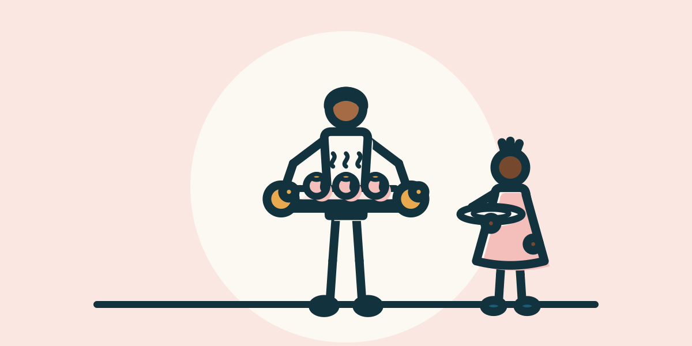
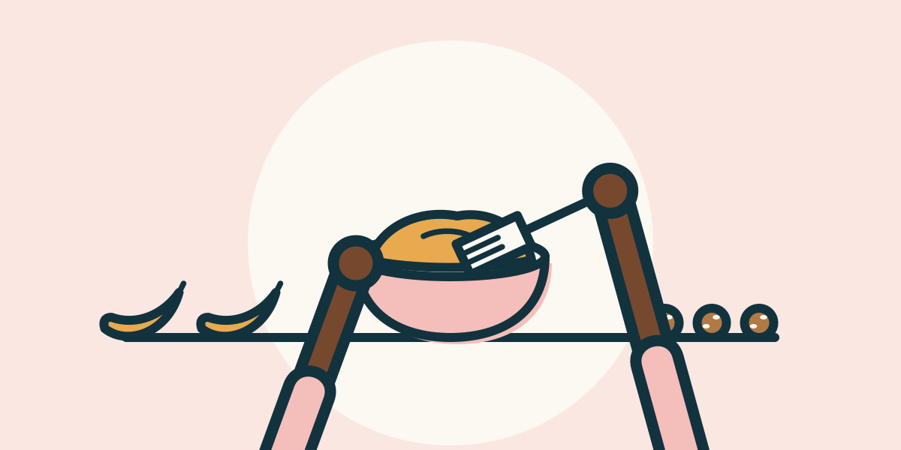
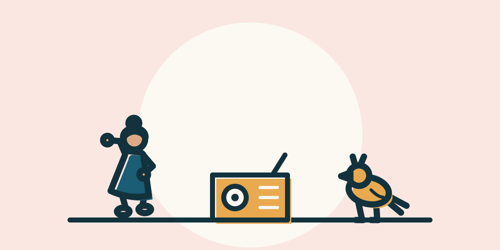
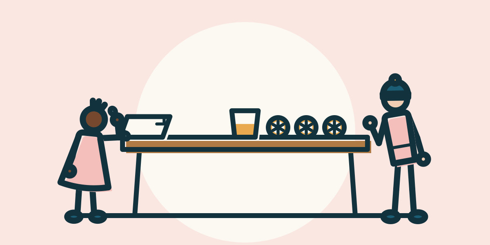

# Probebilder: fünf Titelbilder von Hand (M9b, Schritt 3b)

> **ERZEUGT** von `npm run kit:preview` aus `assets/bausteine/probe/`. Nicht von Hand ändern. Szenen und Bewertungen stehen in den `*.scene.json`, Regeln in [README.md](README.md).

Die fünf Aktivitäten aus dem Modelltest (`docs/bilder-plan.md`), von Hand aus dem Baukasten gesetzt: Kartengröße und Daumennagel (96 × 48 und 64 × 32). Die Texte stammen aus `data/`, die Bratäpfel (KI-Aktivität, nicht in `data/`) aus `assets/bausteine/probe/aktivitaeten.json`. Geprüft mit allen Regeln des Szenenprüfers, auch Sicherheit, „nichts, was der Text nicht sagt“ und (seit dem ersten Bild-Test am 18. Oktober 2026) den Titelbild-Regeln: Figur und Gegenstand, kein `hands`, kein Messer und keine Schere, jeder Gegenstand aus dem Titel im Bild. Deshalb sind die Bananen-Haferkugeln jetzt eine ganze Figur statt einer Nahaufnahme.

## Bratäpfel aus dem Ofen

  

- **Aktivität:** `baked-apples`, 4 bis 12 Jahre, Layout `pair`, 5,1 KB
- **Sicherheitshinweis:** Messer und Backofen nur mit Erwachsenen. Die Füllung wird sehr heiß, lasst sie vor dem Essen gut abkühlen. Rosinen sind für Kinder unter 4 Jahren eine Verschluckgefahr.
- **Prüfergebnis:** bestanden (Layout, Rand, Ecken, Überdeckung, Haltepunkte, 14 KB, Sicherheit, Textabgleich, Titelbild-Regeln)
- **Trägt:** Wer was tut, ist ohne Gesicht klar: Arne trägt das heiße Backblech mit Ofenhandschuhen, Jette wartet mit leerem Teller und Abstand. Der Dampf sagt „frisch aus dem Ofen“, das Bild entspricht dem Sicherheitshinweis (Backofen nur mit Erwachsenen). Backblech statt Tablett, weil der Text „Backblech“ sagt. Der Teller ist neutral (Entscheidung von Clemens): Der Text muss ihn nicht nennen, solange er leer ist oder nichts Heißes trägt.
- **Fehlt:** Die Bratäpfel sind auf der Karte kleine rosa Kugeln mit Honig-Deckel; im Daumennagel sind sie nicht mehr als Äpfel zu erkennen, dort bleibt „jemand trägt ein Blech, ein Kind wartet“. Das Füllen der Äpfel (der Teil für die Kinder) und der Ofen (kein Baustein) fehlen. Die linke Hälfte ist leer; dort sitzt die Pille.
- **Ein Mensch prüft noch:** Liest man „Bratäpfel“ oder nur „Blech mit Kugeln“? Liest man den leeren Teller als Teller oder als Ring? Stört der Dampf vor Arnes Brust?

## Bananen-Haferkugeln

  

- **Aktivität:** `banana-oat-balls`, 3 bis 10 Jahre, Layout `hero`, 4,8 KB
- **Sicherheitshinweis:** Enthält Gluten (Haferflocken). Wascht vorher die Hände.
- **Prüfergebnis:** bestanden (Layout, Rand, Ecken, Überdeckung, Haltepunkte, 14 KB, Sicherheit, Textabgleich, Titelbild-Regeln)
- **Trägt:** Seit dem ersten Bild-Test (18. Oktober 2026) ist `hands` nur noch für Schrittbilder erlaubt. Das Titelbild zeigt deshalb Mats ganz: Er rührt mit der Gabel den Teig in der Schüssel, in der Mitte eine große Schüssel mit fertigen Haferkugeln, rechts ein Teller mit einer Banane. Zutaten aus dem Titel (Bananen, Haferflocken) sind beide im Bild, wie es die neue Regel verlangt; dazu Gabel und Schüssel aus dem Text, der Teller ist neutral. Die alte Nahaufnahme lebt als Schrittbild-Beispiel weiter (`beispiele/banana-oat-balls-step.scene.json`), mit den kürzeren Unterarmen.
- **Fehlt:** Haferflocken und Kakao sind nicht einzeln zu sehen; der Teig ist eine Fläche. Das Rollen der Kugeln mit den Händen (der Kern der Aktivität) ist nicht gezeigt.
- **Ein Mensch prüft noch:** Sehen die Haferkugeln in der Schüssel wie Haferkugeln aus oder wie Kekse? Liest man die Banane auf dem Teller als Banane (gebogen, mit Stiel und dunkler Spitze)?

## Tanz-Freeze

  

- **Aktivität:** `dance-freeze`, 1 bis 12 Jahre, Layout `pair`, 3,4 KB
- **Sicherheitshinweis:** Tanzt barfuß oder auf Stoppersocken, nicht auf rutschigen Socken. Ganz kleine Kinder tanzen auf dem Arm oder an der Hand.
- **Prüfergebnis:** bestanden (Layout, Rand, Ecken, Überdeckung, Haltepunkte, 14 KB, Sicherheit, Textabgleich, Titelbild-Regeln)
- **Trägt:** Radio, ein tanzendes Kind und ein Vogel daneben sagen „Bewegen zu Musik“. Nolli (≈3) passt, weil die Aktivität ab 1 Jahr ist. Besetzung: Stups kommt als Begleiter dazu (gelegentlich, hier erlaubt: kein Ofen, kein Messer). Jette ist damit nur noch in zwei der fünf Bilder.
- **Fehlt:** Das Spiel selbst (Musik stoppt, alle erstarren) ist im Standbild nicht zu sehen. Noten oder Pausenzeichen gibt es nicht (kein Zeichen mit Bedeutung). Nur ein Kind: Die Spanne bis 12 Jahre zeigt sich nicht mehr in zwei Größen. Der Sicherheitshinweis (barfuß, keine rutschigen Socken, ganz Kleine auf dem Arm) ist nicht sichtbar; das muss ein Titelbild nicht leisten. Stups steht nur da: Die Pose `hop` (im Sprung) liest sich im Daumennagel eher als Käfer, deshalb `stand`.
- **Ein Mensch prüft noch:** Ist das Radio als Musik erkennbar (kein Lautsprecher-Symbol, keine Noten)? Liest sich Stups als Mittänzer oder als Zufall im Bild? Wirkt Nolli allein beim Tanzen passend, obwohl der Text sagt, dass ganz kleine Kinder auf dem Arm tanzen? (Nolli ist ≈3, nicht „ganz klein“.)

## Pfützen-Forscher

  

- **Aktivität:** `puddle-explorers`, 2 bis 10 Jahre, Layout `outdoor`, 5,1 KB
- **Sicherheitshinweis:** Erwachsene bleiben die ganze Zeit dabei, vor allem bei kleinen Kindern: Pfützen, Gräben und Bäche können tiefer sein, als sie aussehen. Bei Gewitter geht ihr sofort hinein.
- **Prüfergebnis:** bestanden (Layout, Rand, Ecken, Überdeckung, Haltepunkte, 14 KB, Sicherheit, Textabgleich, Titelbild-Regeln)
- **Trägt:** Alles kommt aus dem Text: Regenjacken, Gummistiefel, die Pfütze, Nolli prüft sie mit dem Stock, Ilka trägt den Eimer mit Blättern. Ilka ist dabei, wie es der Sicherheitshinweis für Kinder unter 6 verlangt. Das stärkste Bild: Die Handlung (Stock in die Pfütze) ist auch im Daumennagel zu erkennen. Besetzung: Jette und Mats sind schon in je zwei Bildern (Grenze 40 %), Nolli passt, weil die Aktivität ab 2 Jahren ist.
- **Fehlt:** Das Springen und Spritzen (der Spaß) fehlt, ebenso Regen, Würmer und Schnecken. Ilkas Kapuze ist Petrol (ihr Hautton trägt darauf); Nolli trägt Rosé.
- **Ein Mensch prüft noch:** Sind die Gummistiefel als Stiefel zu erkennen? Liest sich die Pfütze als Pfütze (Petrol mit Leinen-Wellen) und nicht als Loch oder Teller?

## Geheimschrift mit Zitronensaft

  

- **Aktivität:** `secret-lemon-ink`, 6 bis 12 Jahre, Layout `table`, 5,7 KB
- **Sicherheitshinweis:** Messer und Bügeleisen bedienen nur Erwachsene. Das Bügeleisen bleibt auch nach dem Ausschalten heiß: Stellt es außer Reichweite ab.
- **Prüfergebnis:** bestanden (Layout, Rand, Ecken, Überdeckung, Haltepunkte, 14 KB, Sicherheit, Textabgleich, Titelbild-Regeln)
- **Trägt:** Jette schreibt am Tisch mit dem Wattestäbchen auf Papier, daneben ein Becher mit Saft und drei Zitronenhälften, Mats (≈11) schaut zu. Das ist der Ablauf der Schritte 1 bis 3. Messer und Bügeleisen fehlen bewusst: Beides bedienen nur Erwachsene, und ein Bügeleisen mit Ofenhandschuh wäre falsch.
- **Fehlt:** Das Geheimnis (unsichtbare Schrift, die durch Wärme braun wird) lässt sich nicht zeigen: Das Papier bleibt leer, Schrift ist im Bild verboten. Im Daumennagel ist es „Kinder am Tisch mit gelben Punkten“; der Unterschied zu einer Bastel-Aktivität ist klein.
- **Ein Mensch prüft noch:** Lesen sich die Zitronenhälften als Zitronen (gelber Kreis mit Speichen) oder als Orangen oder Räder? Ist das Wattestäbchen in Jettes Hand zu klein?

## Wie unterscheidbar sind die fünf Bilder?

Mechanisch: **4 verschiedene Layouts** bei 5 Bildern (pair, hero, outdoor, table). Überschneidung der gezeigten Dinge und Figuren je Paar (0 % = nichts gemeinsam):

| | baked-apples | banana-oat-balls | dance-freeze | puddle-explorers | secret-lemon-ink |
| --- | --- | --- | --- | --- | --- |
| baked-apples | – | 9 % | 0 % | 0 % | 10 % |
| banana-oat-balls | 9 % | – | 0 % | 0 % | 8 % |
| dance-freeze | 0 % | 0 % | – | 13 % | 0 % |
| puddle-explorers | 0 % | 0 % | 13 % | – | 0 % |
| secret-lemon-ink | 10 % | 8 % | 0 % | 0 % | – |

Mittlere Überschneidung: **4 %**. Gemeinsam sind fast nur die Figuren.

## Besetzung (Figurenwahl)

Passen mehrere Figuren, kommt die am seltensten benutzte zuerst; keine Figur in mehr als 40 % der Bilder (bei 5 Bildern höchstens 2), Mats bevorzugt ab 8 Jahren, Stups gelegentlich als Begleiter. Regeln: `scripts/lib/kit/casting.ts`, derselbe Code rät im Bild-Test.

| Bild | Rat: Kind | Rat: Erwachsene | Stups | gesperrt | gezeigt | Zähler danach |
| --- | --- | --- | --- | --- | --- | --- |
| baked-apples | jette → mats | arne → ilka | nicht erlaubt | – | arne, jette | arne 1, jette 1 |
| banana-oat-balls | mats → jette | ilka → arne | vorgeschlagen | – | mats | arne 1, jette 1, mats 1 |
| dance-freeze | nolli → jette → mats | ilka → arne | vorgeschlagen | – | nolli, stups | arne 1, jette 1, mats 1, nolli 1, stups 1 |
| secret-lemon-ink | jette → mats | ilka → arne | nicht erlaubt | – | jette, mats | arne 1, jette 2, mats 2, nolli 1, stups 1 |
| puddle-explorers | nolli | ilka → arne | erlaubt | jette, mats | ilka, nolli | arne 1, jette 2, mats 2, nolli 2, stups 1, ilka 1 |

Am Ende: **jette** 2 von 5 (40 %), **mats** 2 von 5 (40 %), **nolli** 2 von 5 (40 %), **arne** 1 von 5 (20 %), **stups** 1 von 5 (20 %), **ilka** 1 von 5 (20 %). Vorher (Stand 3b) stand Jette in allen fünf Bildern.

## Alle fünf nebeneinander

Im Daumennagel:

    

