# Foto-Auswahl für die Kategorie-Karten (Prüfseite)

Stand: 12.10.2026. Quelle: Pixabay (Schnittstelle, ein Lauf von `scripts/find-photos.ts`). Regeln für Fotos:
`docs/design/DESIGN.md`, Abschnitt „Regeln für Fotos“. Die Kandidaten liegen unter `assets/images/candidates/<kategorie>/`,
Herkunft, Fotograf und Lizenz je Bild in `assets/images/candidates/candidates.json`.

**Das ist eine Vorauswahl, keine Freigabe.** Es liegt noch nichts unter `assets/images/categories/` und es gibt noch kein
`docs/bildquellen.md`. Beides kommt nach deiner Auswahl. Vor der Beta schaut ein Mensch ohnehin alle Fotos durch.

## Ergebnis in Kürze

- **Geladen und einzeln angesehen: 70 Bilder (10 je Kategorie). Bestanden: 21.** Bei „unklar“ (Gesichter, Marken, Text) gilt raus.
- **Nur Natur (7) und Kochen (10) haben mindestens vier gute Bilder.** Basteln 1, Spiel 1, Bewegung 0, Experiment 0, Ausflug 2.
  Ich habe keine Kompromisse gemacht, um auf vier zu kommen.
- **Das magere Ergebnis liegt an meiner Auswahl vor dem Download, nicht an Pixabay.** Das Skript hat die Treffer nach Beliebtheit
  und Upload-Jahr sortiert, aber nicht danach, wie gut sie zum Suchbegriff passen. Dadurch kamen Bäume, Schlösser, Laptops und
  Hochhäuser nach vorn (alle regelkonform, aber ohne Bezug zur Kategorie). Eine Auswertung der zwischengespeicherten Antworten
  (ohne Netz, nur die Tags) zeigt je Kategorie grob 40 bis 75 regelkonforme Treffer, deren Tags zum Suchbegriff passen und die
  nicht geladen wurden. Beispiele: Springseile (Pixabay 609726, 1584707, 115131), Gummistiefel in Pfützen (4207330, 4908261),
  Wanderstiefel (2935106, 317904), Aquarell-Malerei (1868562, 4647149), Plätzchen-Backen (5912146, 7006142). Die Bilder selbst habe ich nicht
  gesehen, die Tags sind nur ein grober Hinweis. Beim Spiel zeigt der Zwischenspeicher bei „playing cards“ fast nur Glücksspiel-Motive
  (Tags `gambling`, `casino`); die müsste ein zweiter Lauf über die Tags ausschließen.
- **Vorschlag:** Die Rangfolge im Skript verbessern (Reihenfolge der Pixabay-Treffer und Passung der Tags zum Suchbegriff
  berücksichtigen, schon geladene Bilder auslassen) und einen zweiten, begrenzten Lauf machen. Das braucht deine Freigabe, weil
  die Obergrenzen (25 Suchen, 80 Downloads) bis auf 3 Suchen und 8 Downloads verbraucht sind.

## Wie gesucht wurde

- Filter in der Suche: `image_type=photo`, `orientation=horizontal`, `safesearch=true`, `min_width=1200`. Je Kategorie zwei Begriffe
  normal und einer mit `editors_choice=true` (21 Suchen). Der dritte Begriff wäre Reserve gewesen und wurde nicht gebraucht.
- Vorauswahl nach den Angaben von Pixabay, vor jedem Download: `isAiGenerated=false`, `isLowQuality=false`, `isGRated=true` (fehlt die
  Angabe, zählt das als „nein“), Original mindestens 1200 px breit, deutlich Querformat, keine Tags mit Personen (woman, girl, child,
  people, portrait …) und keine Tags mit Marken, Logos oder Text (logo, lego, label, alphabet …). Aussortiert wurden dabei unter anderem
  2 Treffer wegen KI-Angabe oder fehlender Angabe und etwa 11 wegen niedriger Qualität. **Die drei Felder stehen wirklich in der Antwort**
  (anders als in der Doku-Seite), die Rückfall-Regel „Erscheinungsjahr plus Sichtprüfung“ war nicht nötig. Uploads vor 2022 wurden
  bevorzugt, weil sie nicht KI-generiert sein können.
- Danach pro Kategorie die 10 bestplatzierten (höchstens 3 je Fotograf), heruntergeladen auf 1280 px, mit ImageMagick auf 1200 px
  Breite verkleinert, Metadaten entfernt, alle unter 250 KB.
- Verbraucht (mit Probeabfrage vorab): 22 von 25 Suchen, 72 von 80 Downloads. `X-RateLimit-Remaining` fiel nie unter 79,
  zwischen den Downloads lagen 1,5 s Pause. Abrufdatum aller Bilder: 12.10.2026.

## Was bei Pixabay gilt (Recherche, Stand 12.10.2026)

- **Lizenz** ([Kurzfassung](https://pixabay.com/service/license-summary/), bindend ist die Volltext-Fassung in den
  [Nutzungsbedingungen](https://pixabay.com/service/terms/)): kostenlos, auch für kommerzielle Zwecke, ohne Pflicht zur Namensnennung,
  Bearbeiten erlaubt. Verboten: Bilder unverändert allein verkaufen oder verteilen („Standalone“), Marken und Logos geschäftlich nutzen,
  irreführende Nutzung. Eine App wird nicht ausdrücklich erwähnt; ein Foto als Kartenhintergrund ist keine Standalone-Weitergabe.
  Das ist keine Rechtsberatung.
- **Erkennbare Personen:** Nutzung nur nicht „immoral or illegal“, und Pixabay übernimmt ausdrücklich keine Garantie, dass
  Einwilligungen vorliegen. Unsere Regel „keine erkennbaren Gesichter“ bleibt deshalb nötig.
- **KI-Bilder:** Uploader müssen KI-Bilder kennzeichnen. Einen Such-Parameter zum Ausschließen gibt es nicht, aber das Feld
  `isAiGenerated` in jedem Treffer. Wir filtern damit und prüfen zusätzlich per Auge.
- **Schnittstelle:** 100 Anfragen pro 60 Sekunden, Antworten 24 Stunden zwischenspeichern, Bilder herunterladen statt dauerhaft
  verlinken, frei verfügbar höchstens 1280 px (`largeImageURL`). Pixabay bittet um einen Hinweis zur Herkunft („Bilder: Pixabay“,
  vorgesehen als Info-Bildschirm, siehe CLAUDE.md, „Entscheidungen vor M12“).
- **Grauzone:** Die Nutzungsbedingungen (§ 8) verbieten „Bulk, large-scale or systematic copying“ und automatische Datensammlung „for all
  unauthorised purposes“, die API-Doku „systematische Massen-Downloads“. Ein einmaliger, von Hand ausgelöster Lauf mit unter 100
  Bildern über die offizielle Schnittstelle ist aus meiner Sicht kein Massen-Download. **Eine automatische Pipeline wäre es.**
  Darum steht bei M9b: vorher beim Anbieter anfragen oder eine andere Quelle wählen.
- Die HTML-Seiten `pixabay.com` und `cdn.pixabay.com` sind für Programme hinter einer Cloudflare-Abfrage gesperrt (HTTP 403). Die
  Schnittstelle und die Bild-Downloads funktionieren.

## Wie ich geprüft habe

Jedes der 70 Bilder habe ich einzeln angesehen (bei Zweifeln auch vergrößert). Kriterien: keine erkennbaren Gesichter (auch nicht im
Hintergrund), keine Marken, Logos oder Verpackungen, kein Text, keine KI-Bilder oder Illustrationen, warmes natürliches Licht, nicht
gestellt, passt zur Kategorie. **Grenzen meiner Prüfung:** Sehr kleine Gesichter im Hintergrund und winzige Schriften erkenne ich
nicht immer sicher, deshalb gilt bei Zweifel „raus“. Das „nicht gestellt“ ist bei Stilleben und Flatlays nur bedingt erfüllbar; ich habe
sie nicht deshalb allein aussortiert, aber in der Spalte „Befund“ vermerkt.

## Kandidaten und Befunde

Pro Kategorie: bestandene Bilder (empfohlene zuerst), darunter eingeklappt die aussortierten mit Grund. Die Tabellen werden mit
`npm run photos:find -- --publish <Befund-Datei>` aus meinen Befunden erzeugt.

<!-- tabellen:start -->

### Basteln (`craft`)

Geladen: 10 · bestanden: 1 · empfohlen: 1 · aussortiert: 9

| Vorschau | Datei | Fotograf | Foto-Seite | Befund | Empfehlung |
| --- | --- | --- | --- | --- | --- |
| 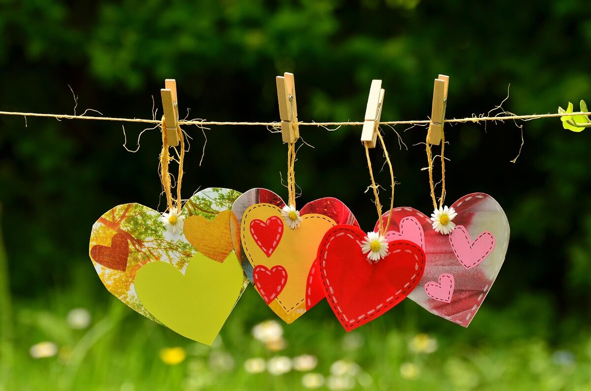 | `craft-1450300.jpg` | [congerdesign](https://pixabay.com/users/509903/) | [Pixabay 1450300](https://pixabay.com/photos/hearts-clothespins-clothesline-hang-1450300/) | Gesichter: nein · Marken: nein · Text: nein. Papierherzen mit Wäscheklammern und Gänseblümchen vor grüner Wiese, Tageslicht, keine Personen. Vorbehalt: bunt und frisch statt ruhig und warm, aufgebautes Stillleben, einziges bestandenes Bild der Kategorie | **empfohlen** |

Aussortiert (9)

- [1468883](https://pixabay.com/photos/paper-brown-texture-background-1468883/): Kraftpapier-Textur, nur eine Fläche ohne Bastel-Aussage
- [3196481](https://pixabay.com/photos/laptop-office-hand-writing-3196481/): Büro mit lesbarem Dokumenttext, kühles Licht, kein Basteln
- [3155438](https://pixabay.com/photos/paper-texture-wrapping-paper-3155438/): Zerknülltes Papier, nur Textur in kühlem Grau
- [1851483](https://pixabay.com/photos/art-watercolors-arts-and-crafts-1851483/): Aquarellkasten und Pinsel passen gut, aber aufgedruckte Schrift auf dem grünen Stift (Marke/Text unklar, deshalb raus)
- [1209519](https://pixabay.com/photos/art-paint-water-colors-desk-artist-1209519/): Pinselgriffe mit Aufdruck und Strichcode, wirkt wie eine Fotomontage
- [1985856](https://pixabay.com/photos/desktop-laptop-crafts-still-life-1985856/): Laptop und Tablet mit Text („50% SALE“, „SHOP NOW“), Karten mit Schrift
- [1284248](https://pixabay.com/photos/arm-hand-write-planner-planning-1284248/): Handschrift „My Plan:“ im Notizbuch, kein Basteln
- [256887](https://pixabay.com/photos/photos-hands-hold-old-256887/): Mann mit Brille im Anschnitt (Gesicht), die Altfotos zeigen ein Kindergesicht
- [1891732](https://pixabay.com/photos/pencil-notebook-crumpled-paper-1891732/): Bleistift auf Karoblock: Schreibwaren statt Basteln

### Spiel (`game`)

Geladen: 10 · bestanden: 1 · empfohlen: 1 · aussortiert: 9

| Vorschau | Datei | Fotograf | Foto-Seite | Befund | Empfehlung |
| --- | --- | --- | --- | --- | --- |
|  | `game-1511866.jpg` | [stevepb](https://pixabay.com/users/282134/) | [Pixabay 1511866](https://pixabay.com/photos/checkmate-chess-board-chess-board-1511866/) | Gesichter: nein · Marken: nein · Text: nein. Schachfiguren auf Holzbrett in warmen Holztönen, Nahaufnahme mit Tiefenunschärfe, keine Personen. Einziges bestandenes Bild der Kategorie | **empfohlen** |

Aussortiert (9)

- [1280537](https://pixabay.com/photos/cup-of-coffee-laptop-office-macbook-1280537/): Laptop mit Tastenbeschriftung (Marke/Text) und Kaffeetasse, kein Spiel
- [83761](https://pixabay.com/photos/autumn-leaves-foliage-autumn-leaves-83761/): Herbstlaub: schön und warm, passt aber zu Natur, nicht zu Spiel
- [1777859](https://pixabay.com/photos/valentines-day-background-tic-tac-toe-1777859/): Tic-Tac-Toe auf Schiefertafel, aber dunkles Studiolicht und Herz-Motiv, nicht warm und natürlich
- [2730034](https://pixabay.com/photos/chess-board-game-board-game-2730034/): Schach in Schwarz-Weiß, dunkel und dramatisch
- [2850091](https://pixabay.com/photos/journal-write-blank-pages-notes-2850091/): Notizbuch mit Stift (Aufdruck am Stift), kein Spiel
- [2727443](https://pixabay.com/photos/chess-king-chess-pieces-pawns-2727443/): Schach in Schwarz-Weiß vor Schwarz, dunkel
- [316658](https://pixabay.com/photos/chess-board-game-chess-board-316658/): Schach in Schwarz-Weiß, Buchstaben D/E/F am Brettrand (Text)
- [2278471](https://pixabay.com/photos/streets-night-lights-circle-2278471/): Autobahnkreuz bei Nacht aus der Luft, kein Spiel
- [1337986](https://pixabay.com/photos/turntable-computer-workspace-1337986/): Plattenspieler, Laptop und Maus mit Apfel-Logo, kein Spiel

### Bewegung (`movement`)

Geladen: 10 · bestanden: 0 · empfohlen: 0 · aussortiert: 10

_Kein Bild hat die Regeln bestanden._

Aussortiert (10)

- [3097419](https://pixabay.com/photos/tree-nature-wood-bare-tree-tribe-3097419/): Kahle Bäume im Winterlicht: Natur, keine Bewegung
- [2571788](https://pixabay.com/photos/winter-landscape-trees-snow-nature-2571788/): Nebel und Bäume im Schnee: Natur, keine Bewegung
- [407256](https://pixabay.com/photos/trees-silhouettes-mysterious-407256/): Dunkle Baumsilhouette: düster, keine Bewegung
- [1749508](https://pixabay.com/photos/travel-lake-feet-resting-hiking-1749508/): Füße in Turnschuhen über einem See: passt eher zu Ausflug, das Schuhdesign wirkt wie eine Marke (unklar, deshalb raus)
- [3072431](https://pixabay.com/photos/tree-sunset-nature-dawn-landscape-3072431/): Baum im Sonnenuntergang: Natur, keine Bewegung
- [3119812](https://pixabay.com/photos/architecture-neuschwanstein-castle-3119812/): Schloss Neuschwanstein: Wahrzeichen, keine Bewegung
- [164915](https://pixabay.com/photos/tree-landscape-nature-bare-tree-164915/): Baum vor Wolkenhimmel: Natur, keine Bewegung
- [5116436](https://pixabay.com/photos/castle-neuschwanstein-bavaria-5116436/): Schloss Neuschwanstein: Wahrzeichen, keine Bewegung
- [5861901](https://pixabay.com/photos/pasture-fog-birds-grass-field-5861901/): Frostige Felder im Morgenlicht: Landschaft, keine Bewegung
- [8740266](https://pixabay.com/photos/goose-bird-green-grass-sunlight-8740266/): Graugans im Gras: Tierfoto, keine Bewegung

### Experiment (`experiment`)

Geladen: 10 · bestanden: 0 · empfohlen: 0 · aussortiert: 10

_Kein Bild hat die Regeln bestanden._

Aussortiert (10)

- [2256489](https://pixabay.com/photos/architecture-skyscraper-2256489/): Glasfassade eines Hochhauses, kein Experiment
- [1327811](https://pixabay.com/photos/hands-massage-treatment-fingers-1327811/): Hände bei einer Massage auf weißem Stoff, medizinisch, kein Experiment
- [2815641](https://pixabay.com/photos/laboratory-analysis-chemistry-2815641/): Profi-Labor mit beschrifteten Flaschen und Laborkittel (Rückenansicht), nicht kindgerecht
- [2030265](https://pixabay.com/photos/analysis-biochemistry-biologist-2030265/): Mikroskop mit Gravur am Objektiv, kühles Blau
- [217043](https://pixabay.com/photos/lab-research-chemistry-test-217043/): Laborglas mit aufgedruckten Marken und Zahlen („Pyrex“, „MBL“)
- [2474993](https://pixabay.com/photos/milk-glass-pitcher-fresh-2474993/): Milchkrug vor Sonnenblumen: warm und schön, passt aber zu Kochen, nicht zu Experiment
- [6544618](https://pixabay.com/photos/raindrop-glass-rain-window-wet-6544618/): Regentropfen an einer Scheibe, kühle Farben, kein Experiment
- [3122210](https://pixabay.com/photos/skyscraper-glass-facade-facade-3122210/): Hochhaus von unten, kein Experiment
- [3853492](https://pixabay.com/photos/water-glass-liquid-wet-refreshment-3853492/): Wasserglas mit Diamant vor Sternenhimmel: Bildmontage, kühl, kein Experiment
- [217041](https://pixabay.com/photos/laboratory-apparatus-equipment-217041/): Laborglas mit aufgedruckten Marken und Zahlen („Pyrex“, „MBL“)

### Natur (`nature`)

Geladen: 10 · bestanden: 7 · empfohlen: 4 · aussortiert: 3

| Vorschau | Datei | Fotograf | Foto-Seite | Befund | Empfehlung |
| --- | --- | --- | --- | --- | --- |
| 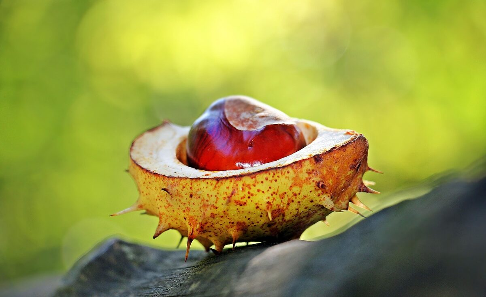 | `nature-1698730.jpg` | [NoName_13](https://pixabay.com/users/2364555/) | [Pixabay 1698730](https://pixabay.com/photos/chestnut-autumn-spur-open-1698730/) | Gesichter: nein · Marken: nein · Text: nein. Aufgeplatzte Kastanie vor grünem Unschärfehintergrund, Nahaufnahme, warmes Gegenlicht | **empfohlen** |
| 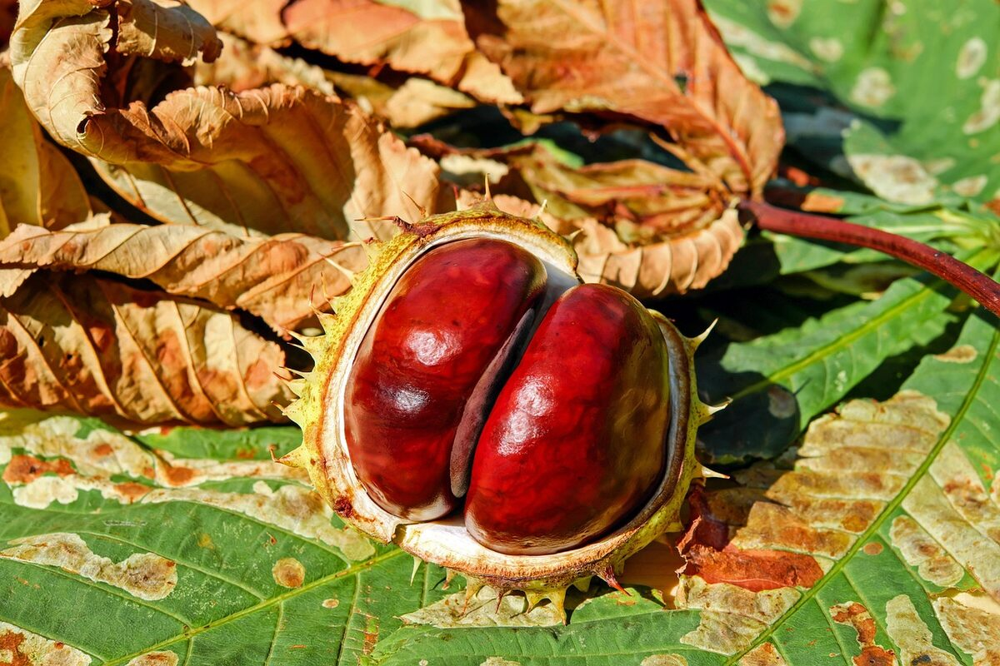 | `nature-2740751.jpg` | [Couleur](https://pixabay.com/users/1195798/) | [Pixabay 2740751](https://pixabay.com/photos/chestnut-fall-buckeye-2740751/) | Gesichter: nein · Marken: nein · Text: nein. Offene Kastanie auf Blättern im Sonnenlicht, Nahaufnahme, kräftige Farben | **empfohlen** |
| 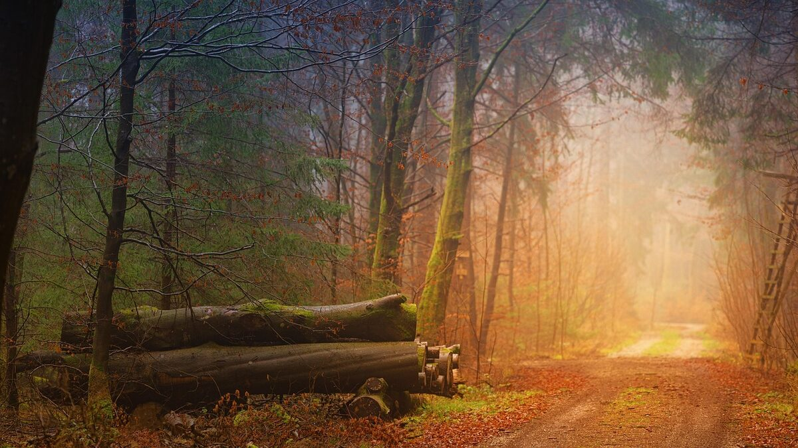 | `nature-3193305.jpg` | [jplenio](https://pixabay.com/users/7645255/) | [Pixabay 3193305](https://pixabay.com/photos/fall-fog-forest-tree-trunks-path-3193305/) | Gesichter: nein · Marken: nein · Text: nein. Waldweg mit Holzstämmen im warmen Nebellicht; Hochsitz-Leiter am Rand, keine Personen | **empfohlen** |
| 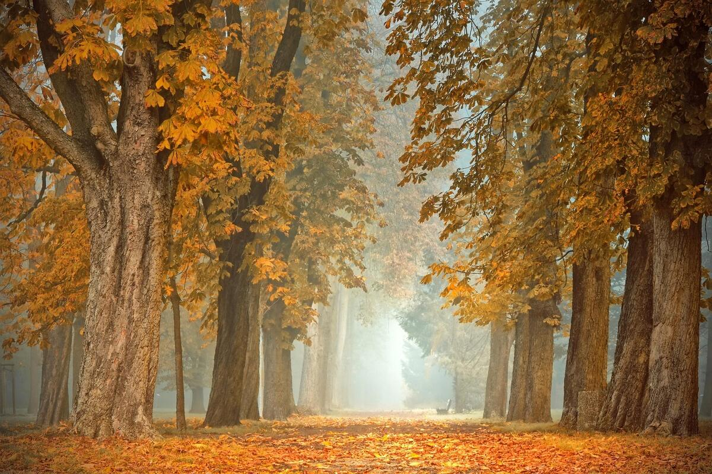 | `nature-4591121.jpg` | [Peggychoucair](https://pixabay.com/users/1130890/) | [Pixabay 4591121](https://pixabay.com/photos/path-trees-autumn-fog-avenue-fall-4591121/) | Gesichter: nein · Marken: nein · Text: nein. Kastanienallee im Nebel, warmes Herbstlicht; weit hinten eine Bank, keine Personen | **empfohlen** |
| 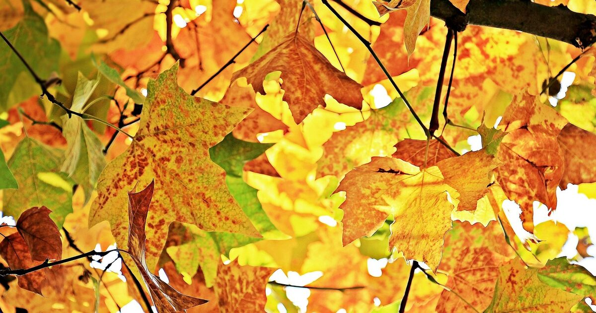 | `nature-1655915.jpg` | [NoName_13](https://pixabay.com/users/2364555/) | [Pixabay 1655915](https://pixabay.com/photos/chestnut-leaves-leaves-autumn-1655915/) | Gesichter: nein · Marken: nein · Text: nein. Gelbe Herbstblätter im Gegenlicht, Nahaufnahme; einige grelle weiße Stellen im Himmel | – |
| 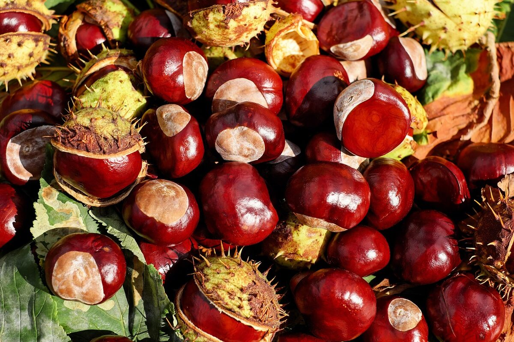 | `nature-1710430.jpg` | [Couleur](https://pixabay.com/users/1195798/) | [Pixabay 1710430](https://pixabay.com/photos/chestnut-fruit-food-nut-edible-1710430/) | Gesichter: nein · Marken: nein · Text: nein. Haufen Kastanien in kräftigen Farben, Nahaufnahme, etwas unruhig | – |
| 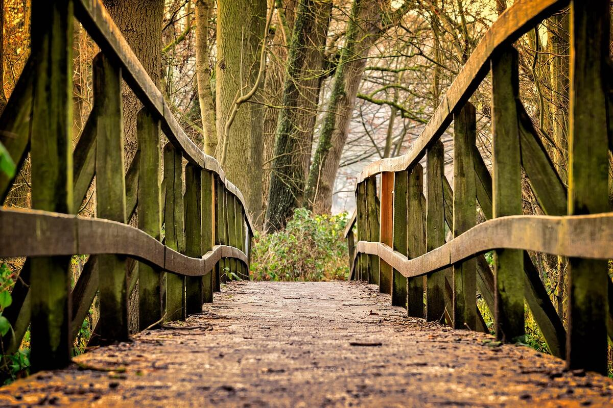 | `nature-3024773.jpg` | [Tama66](https://pixabay.com/users/1032521/) | [Pixabay 3024773](https://pixabay.com/photos/bridge-path-park-wooden-bridge-3024773/) | Gesichter: nein · Marken: nein · Text: nein. Holzsteg im herbstlichen Wald, warmes Licht, keine Personen; deutlich nachbearbeitet (HDR-Look) | – |

Aussortiert (3)

- [5704083](https://pixabay.com/photos/road-curve-trees-highway-leaves-5704083/): Kurvenstraße im Herbstwald, zwei winzige Personen am Geländer (nicht erkennbar, aber unklar, deshalb raus), Straße statt Natur
- [1685924](https://pixabay.com/photos/fall-leaves-golden-autumn-1685924/): Laub auf Pflaster, extremes Panorama (1200×374), für das Kartenformat zu schmal
- [437769](https://pixabay.com/photos/autumn-leaves-foliage-autumn-leaves-437769/): Himbeerblätter vor Schwarz, dunkler Studio-Look

### Kochen (`cooking`)

Geladen: 10 · bestanden: 10 · empfohlen: 4 · aussortiert: 0

| Vorschau | Datei | Fotograf | Foto-Seite | Befund | Empfehlung |
| --- | --- | --- | --- | --- | --- |
| 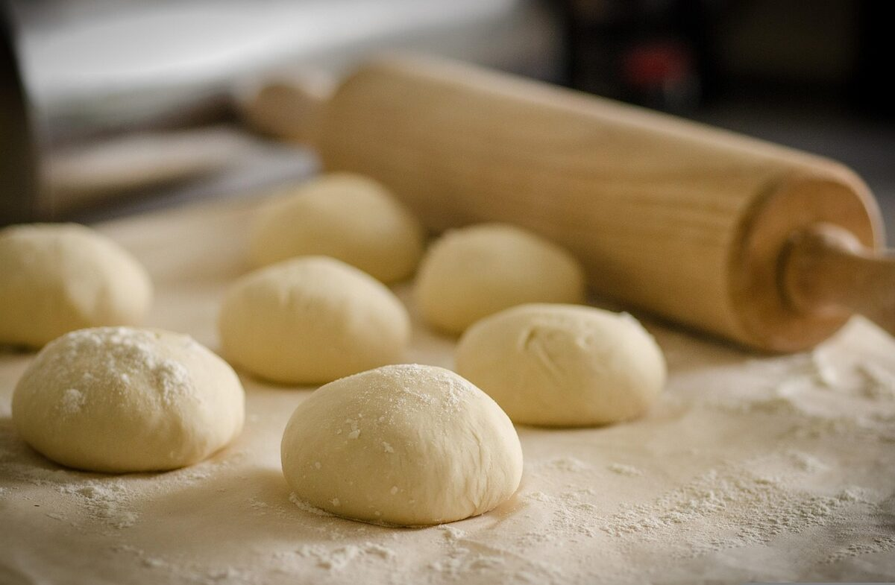 | `cooking-943245.jpg` | [ClickerHappy](https://pixabay.com/users/324082/) | [Pixabay 943245](https://pixabay.com/photos/new-year-background-dough-cook-943245/) | Gesichter: nein · Marken: nein · Text: nein. Teigkugeln und Nudelholz in weichem, warmem Licht, Nahaufnahme | **empfohlen** |
| 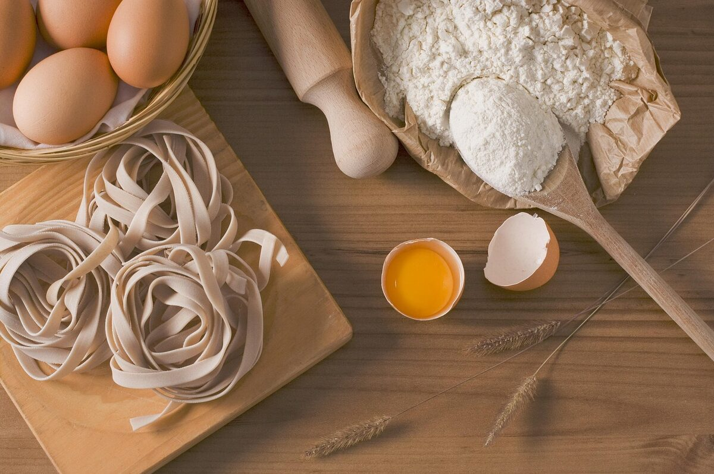 | `cooking-1181189.jpg` | [Oldmermaid](https://pixabay.com/users/1999835/) | [Pixabay 1181189](https://pixabay.com/photos/pasta-fettuccine-fresh-pasta-1181189/) | Gesichter: nein · Marken: nein · Text: nein. Nudelnester, Eier, Mehl in Papiertüte und Nudelholz auf Holz von oben, warmes Licht | **empfohlen** |
| 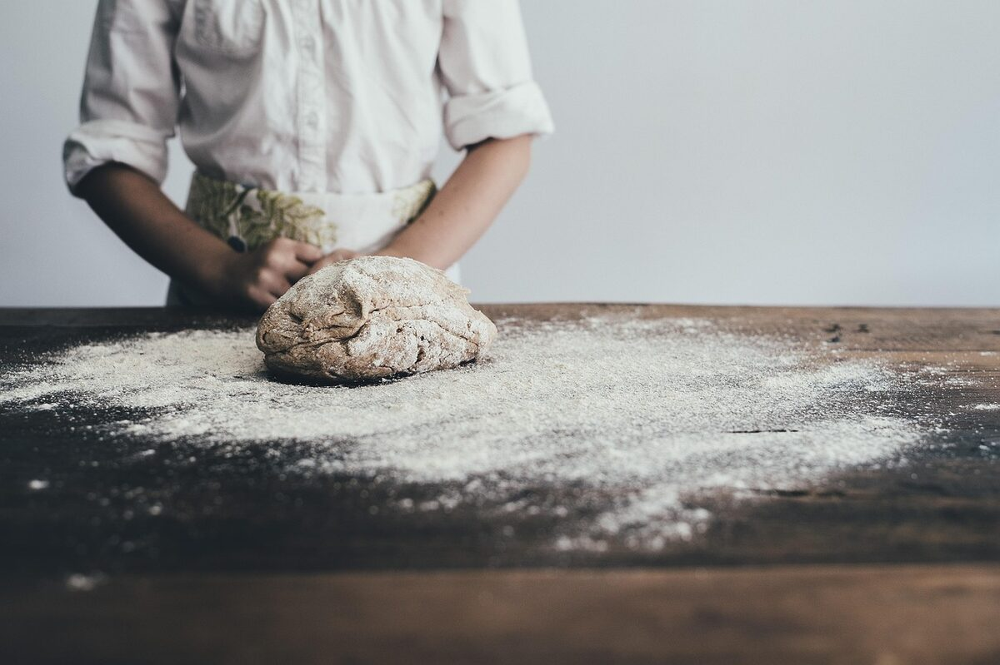 | `cooking-1868396.jpg` | [Pexels](https://pixabay.com/users/2286921/) | [Pixabay 1868396](https://pixabay.com/photos/bakery-bread-baker-apron-baking-1868396/) | Gesichter: nein · Marken: nein · Text: nein. Hände kneten Teig auf bemehltem Tisch; Kopf nicht im Bild (nur Oberkörper und Schürze). Licht eher kühl-grau, Motiv passt genau zur Bildsprache | **empfohlen** |
| 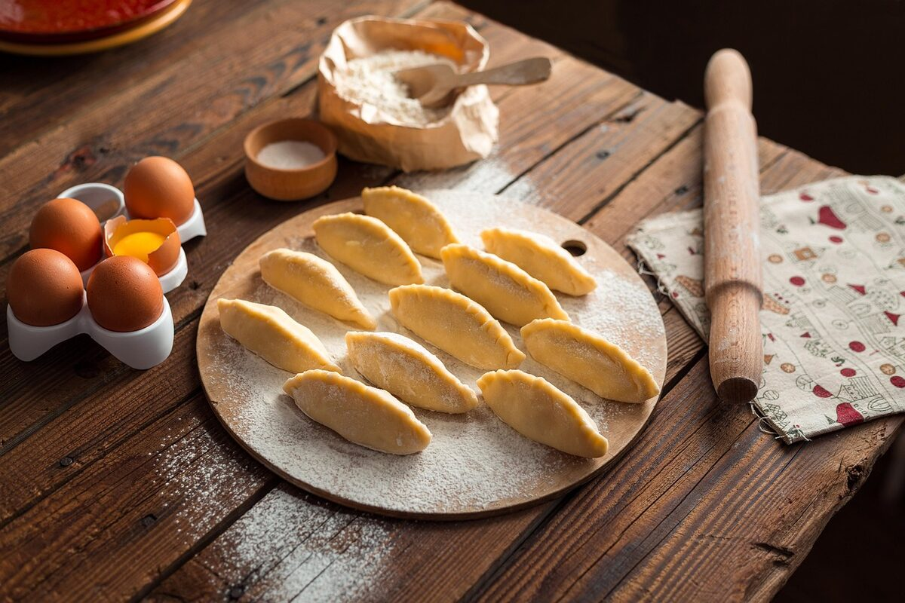 | `cooking-2132874.jpg` | [Daria-Yakovleva](https://pixabay.com/users/3938704/) | [Pixabay 2132874](https://pixabay.com/photos/cooking-pies-vareniki-pelmeni-cook-2132874/) | Gesichter: nein · Marken: nein · Text: nein. Gefüllte Teigtaschen auf Holzbrett im warmen Dämmerlicht; Leinentuch nur mit Muster, rechte Bildseite dunkel | **empfohlen** |
| 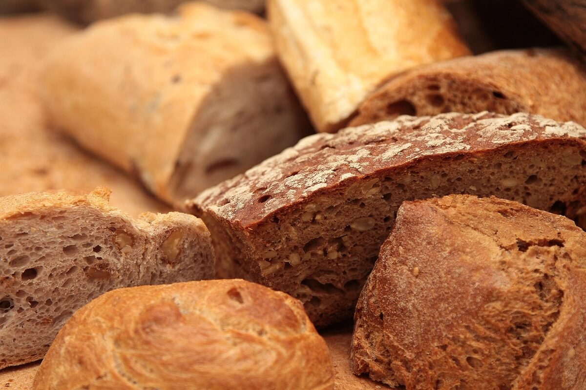 | `cooking-399286.jpg` | [TiBine](https://pixabay.com/users/238708/) | [Pixabay 399286](https://pixabay.com/photos/bread-food-baked-artisan-breads-399286/) | Gesichter: nein · Marken: nein · Text: nein. Aufgeschnittene Brote in warmen Tönen; zeigt das Ergebnis, nicht das Tun | – |
| 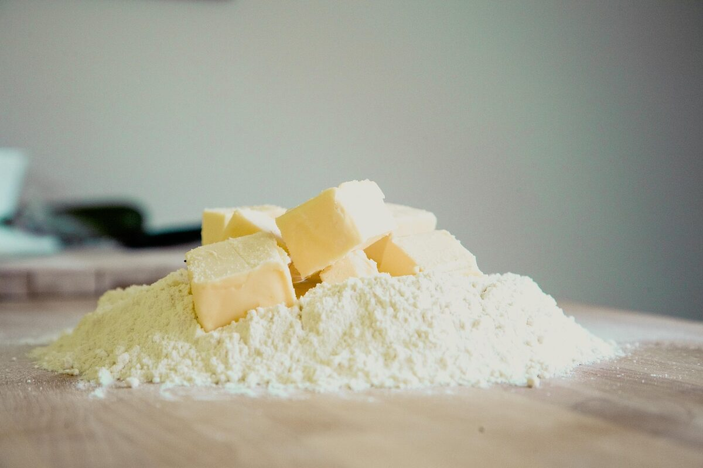 | `cooking-599521.jpg` | [markusspiske](https://pixabay.com/users/670330/) | [Pixabay 599521](https://pixabay.com/photos/bake-butter-flour-pile-599521/) | Gesichter: nein · Marken: nein · Text: nein. Butterwürfel auf Mehl, weiches Licht, unscharfer Hintergrund | – |
| 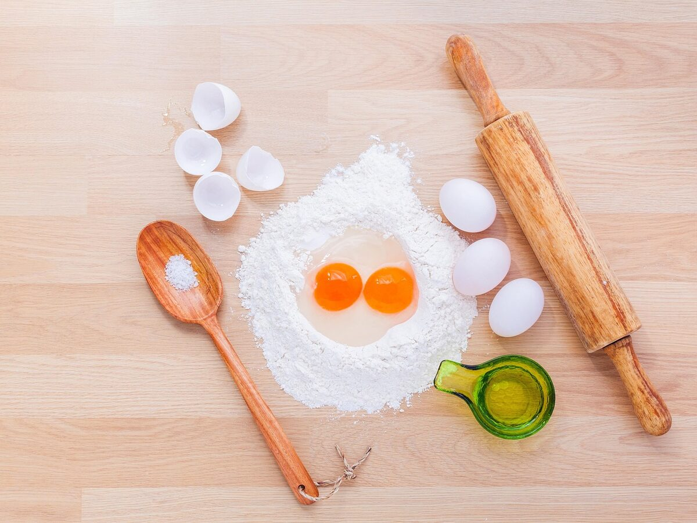 | `cooking-906135.jpg` | [kerdkanno](https://pixabay.com/users/1334070/) | [Pixabay 906135](https://pixabay.com/photos/egg-flour-happy-easter-cooking-906135/) | Gesichter: nein · Marken: nein · Text: nein. Mehlhaufen mit Eiern und Nudelholz auf hellem Holz von oben; hell und aufgeräumt, eher gestellt | – |
| 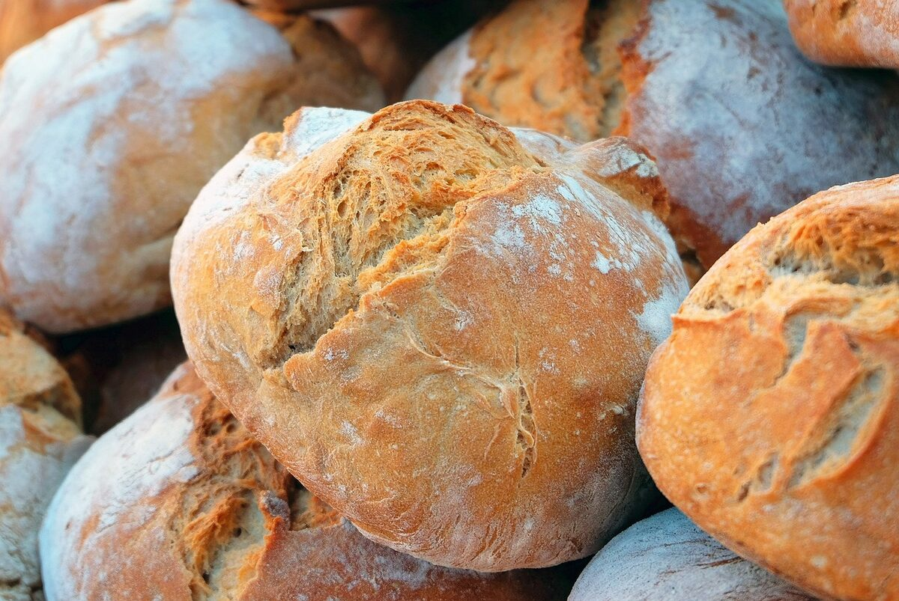 | `cooking-1281053.jpg` | [Couleur](https://pixabay.com/users/1195798/) | [Pixabay 1281053](https://pixabay.com/photos/bread-baked-food-freshly-baked-1281053/) | Gesichter: nein · Marken: nein · Text: nein. Brötchen in Nahaufnahme, warmes Licht; zeigt das Ergebnis, nicht das Tun | – |
| 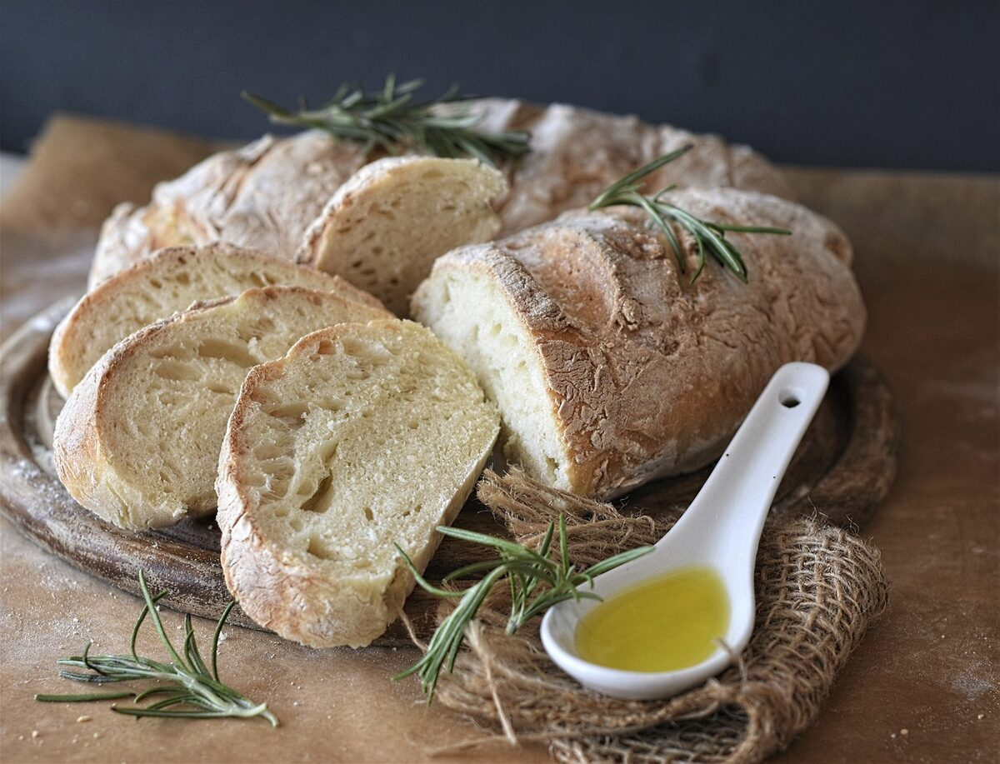 | `cooking-4957679.jpg` | [RitaE](https://pixabay.com/users/19628/) | [Pixabay 4957679](https://pixabay.com/photos/loaf-ciabatta-flour-wheat-flour-4957679/) | Gesichter: nein · Marken: nein · Text: nein. Brot mit Rosmarin und Olivenöl, warmes Foodstyling auf dunklem Grund | – |
| 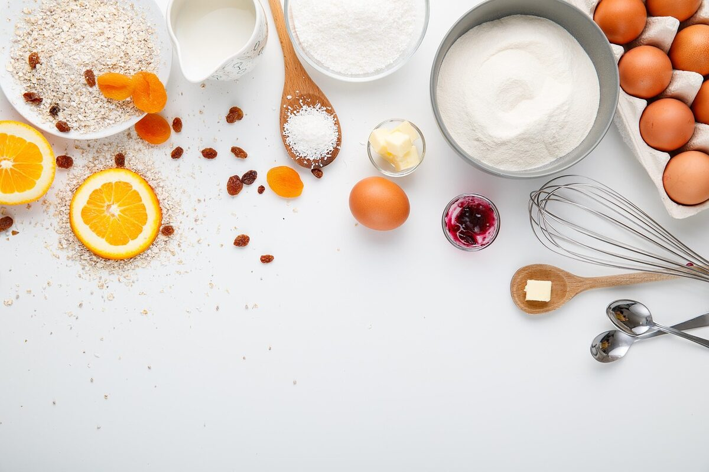 | `cooking-5880136.jpg` | [sontung57](https://pixabay.com/users/19733131/) | [Pixabay 5880136](https://pixabay.com/photos/cooking-ingredients-flat-lay-bake-5880136/) | Gesichter: nein · Marken: nein · Text: nein. Backzutaten von oben auf Weiß; hell und kühl, eher Studio | – |

### Ausflug (`outing`)

Geladen: 10 · bestanden: 2 · empfohlen: 1 · aussortiert: 8

| Vorschau | Datei | Fotograf | Foto-Seite | Befund | Empfehlung |
| --- | --- | --- | --- | --- | --- |
| 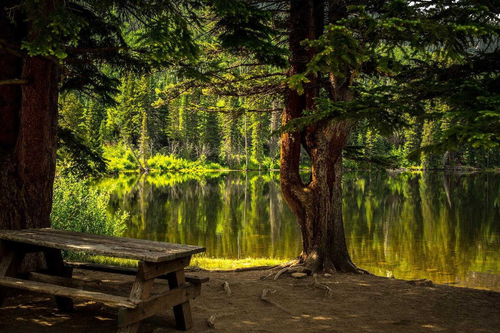 | `outing-2178847.jpg` | [Pexels](https://pixabay.com/users/2286921/) | [Pixabay 2178847](https://pixabay.com/photos/bench-lake-park-recreational-area-2178847/) | Gesichter: nein · Marken: nein · Text: nein. Picknicktisch an einem Waldsee im warmen Licht, keine Personen, kein Text | **empfohlen** |
| 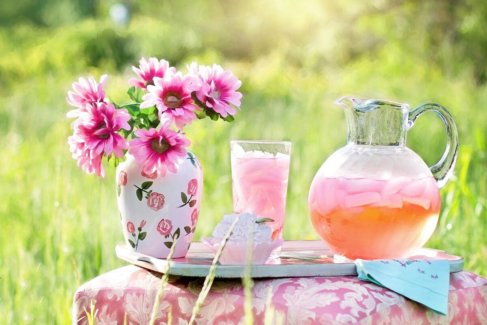 | `outing-795029.jpg` | [JillWellington](https://pixabay.com/users/334088/) | [Pixabay 795029](https://pixabay.com/photos/pink-lemonade-summer-outdoors-795029/) | Gesichter: nein · Marken: nein · Text: nein. Limonade und Blumen auf einem Tisch in der Wiese, Sonnenlicht; sehr gestellt und pastellrosa, wirkt eher verspielt | – |

Aussortiert (8)

- [1979674](https://pixabay.com/photos/christmas-wallpaper-relaxing-1979674/): Fernbedienung mit „Panasonic“-Schriftzug, Handy- und Tablet-Display, Wohnzimmer statt Ausflug
- [1975215](https://pixabay.com/photos/warm-and-cozy-popcorn-coffee-1975215/): Popcorn und Tasse am Kamin: gemütlich zu Hause, kein Ausflug
- [1284041](https://pixabay.com/photos/coffee-cup-macbook-laptop-working-1284041/): Laptop mit Apfel-Logo im Bett, kein Ausflug
- [3071334](https://pixabay.com/photos/dog-cute-animal-pet-puppy-looking-3071334/): Hundegesicht in Großaufnahme, kein Ausflug
- [820149](https://pixabay.com/photos/pillows-sheets-bed-linen-820149/): Bettwäsche in Schwarz-Weiß, kein Ausflug
- [1839184](https://pixabay.com/photos/bed-bedroom-closet-furniture-lamp-1839184/): Schlafzimmer, kein Ausflug
- [5727263](https://pixabay.com/photos/chair-home-room-plant-ivy-5727263/): Sessel mit Decke und Pflanze, Wohnzimmer, kein Ausflug
- [3524649](https://pixabay.com/photos/sausages-barbecue-grill-3524649/): Nahaufnahme von Grillwürsten: wirkt wie Essen, nicht wie Ausflug (Grenzfall)

<!-- tabellen:ende -->

## Nächste Schritte

1. Du wählst je Kategorie die Bilder aus, die bleiben sollen (Natur und Kochen sind bereit; für Basteln, Spiel, Bewegung, Experiment und
   Ausflug fehlt Auswahl).
2. Entscheidung zum **zweiten Lauf** mit besserer Rangfolge (siehe „Ergebnis in Kürze“): Wie viele zusätzliche Suchen und Downloads
   dürfen es sein?
3. Danach: gewählte Fotos nach `assets/images/categories/`, `docs/bildquellen.md` anlegen, nicht gewählte Kandidaten löschen.
