# Figuren: die Besetzung (festgeschrieben)

> **ERZEUGT** von `npm run figures:preview` aus `scripts/lib/figures/`. Nicht von Hand ändern. Regeln und Entscheidungen: [`docs/design/FIGUREN.md`](../FIGUREN.md).

Satz C „schlank und verspielt“ mit Hautton-Variante A, ohne Augenpunkte (Emotionen über Haltung und Bewegung), Papa Arne, Junge Mats. Figurenlinie 5, Gegenstände 4, feine Linien 2,5.

## Besetzung

| Name | Rolle in der App | Alter | passt zu Aktivitäten (Altersspanne) | Standhöhe | Hautton | Beschreibung |
| --- | --- | --- | --- | --- | --- | --- |
| **Nolli** | Nebenfigur (kleineres Kind) | ≈ 3 | 0 bis 4 Jahre | 67 | Platz 2 `#DDAA85` | das kleinste Kind (≈3): Dutt, Petrol-Kleidchen |
| **Jette** | Hauptfigur (größeres Kind) | ≈ 7 | 3 bis 9 Jahre | 88 | Platz 7 `#76492F` | das größere Kind (≈7): Haarbüschel, Rosé-Kleid |
| **Mats** | Hauptfigur (älteres Kind) | ≈ 11 | 8 bis 16 Jahre | 105 | Platz 1 `#F1CDB3` | der ältere Junge (≈11): Mütze, Rosé-Shirt, die Hand in der Hüfte |
| **Ilka** | Nebenfigur (Erwachsene) | Erwachsene | jede | 120 | Platz 3 `#C48A62` | die Mutter: groß und schlank, langer Mantel, Schal |
| **Arne** | Nebenfigur (Erwachsene) | Erwachsene | jede | 123 | Platz 5 `#A56B45` | der Papa: noch etwas größer, Leinen-Pullover, kurze Haare |
| **Stups** | Hauptfigur (Begleiter) | – | jede (nie bei Hitze, Feuer, Messer, Schere) | 50 | – | der Vogel (Hauptfigur, Begleiter): dünne Beine, langer Schwanz, Haarschopf |
| **Tüpfel** | Cameo-Figur | – | jede (nie bei Hitze, Feuer, Messer, Schere) | 55 | – | die Katze (Cameo): schlank, langer Schwanz, spitze Ohren |

Namensprüfung: Nolli (keine bekannte Kinderfigur gefunden); Jette (keine bekannte Figur, nur eine Buchreihe „Jette“ von Fee Krämer (Erwachsenen- bis Jugendbuch)); Ilka (keine bekannte Kinderfigur gefunden); Tüpfel (keine bekannte Figur (nur „Tüpfelblatt“ aus Warrior Cats, anderer Name)); Stups (keine bekannte Kinderfigur gefunden); Arne (Vorschlag für den Papa: keine Kinderfigur gefunden (nur der Krimiautor Arne Dahl, ein Erwachsenen-Name)); Mats (Vorschlag für den Jungen: nur das Bilderbuch „Mats und Mathilde“, keine bekannte Figur); Malte (Alternative für den Papa: keine Kinderfigur gefunden (sehr häufiger Vorname)); Tore (Alternative für den Jungen: keine Kinderfigur gefunden (nordisch, kurz)).

## Die Besetzung zusammen

Von links nach rechts: Nolli, Jette, Mats, Ilka, Arne, Tüpfel, Stups. Karte, 96 × 48 und 64 × 32.

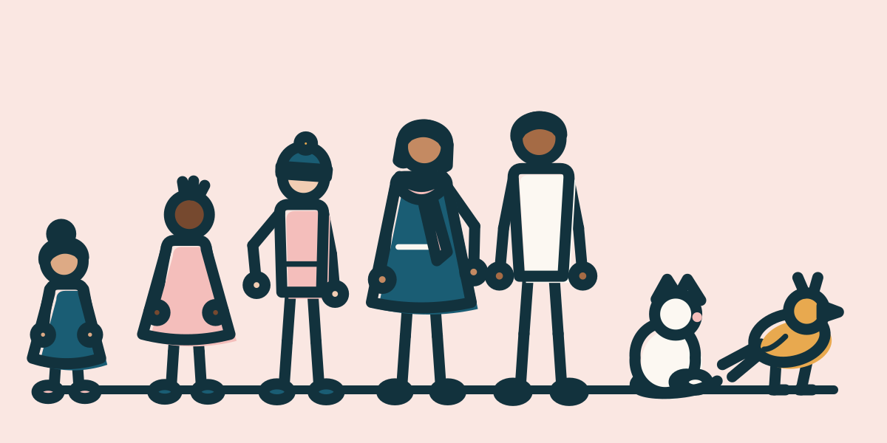  

## Hauttöne

Acht Töne, Farbton 21° bis 26° (ohne Gelb- und ohne Rotstich). Regel: Ein Ton **trägt** auf einem Hintergrund, wenn die Haut gegen den Hintergrund mindestens 3:1 hat **oder** der Tinten-Umriss gegen die Haut mindestens 3:1 (bei gesichtslosen Köpfen trägt die Form der Haut oder der Umriss). WCAG-Kontrast, `src/lib/contrast.ts`.

| Platz | Ton | Figur | Haut gegen Leinen | Rosé | Bildgrund | Petrol | Tinte gegen Haut | trägt auf Leinen / Rosé / Bildgrund / Petrol |
| --- | --- | --- | --- | --- | --- | --- | --- | --- |
| 1 | `#F1CDB3` | Mats | 1,4:1 | 1,1:1 | 1,2:1 | 4,9:1 | 9,1:1 | ja / ja / ja / ja |
| 2 | `#DDAA85` | Nolli | 2,0:1 | 1,3:1 | 1,7:1 | 3,6:1 | 6,6:1 | ja / ja / ja / ja |
| 3 | `#C48A62` | Ilka | 2,8:1 | 1,8:1 | 2,5:1 | 2,5:1 | 4,6:1 | ja / ja / ja / ja |
| 4 | `#B07A52` | Reserve | 3,5:1 | 2,2:1 | 3,1:1 | 2,0:1 | 3,7:1 | ja / ja / ja / ja |
| 5 | `#A56B45` | Arne | 4,1:1 | 2,7:1 | 3,7:1 | 1,7:1 | 3,1:1 | ja / ja / ja / ja |
| 6 | `#8C5C3E` | Reserve | 5,3:1 | 3,5:1 | 4,7:1 | 1,3:1 | 2,4:1 | ja / ja / ja / **nein** |
| 7 | `#76492F` | Jette | 7,2:1 | 4,7:1 | 6,4:1 | 1,0:1 | 1,8:1 | ja / ja / ja / **nein** |
| 8 | `#613A25` | Reserve | 9,3:1 | 6,0:1 | 8,2:1 | 1,3:1 | 1,4:1 | ja / ja / ja / **nein** |

Hintergründe: Leinen `#FCF8F2`, Rosé `#F4BEBB`, Petrol `#1A5D74`, Bildgrund `#FAE7E2`.

## Figurenblätter

Von links nach rechts: stehen, hält einen Teller mit Apfel, trägt ein Tablett (Erwachsene mit Ofenhandschuhen und heißen Äpfeln, Kinder mit kalten Keksen), jubelt.

| Figur | Karte | 96 × 48 | 64 × 32 |
| --- | --- | --- | --- |
| Nolli | 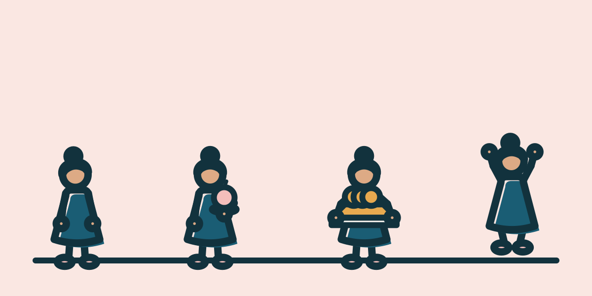 |  |  |
| Jette | 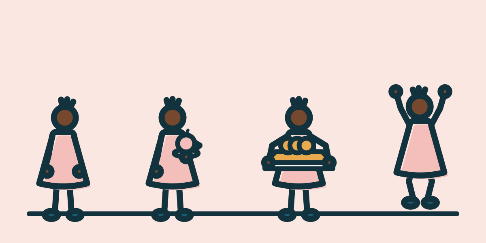 |  |  |
| Mats | 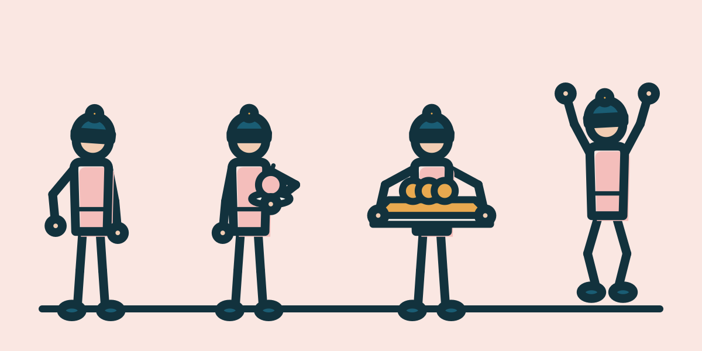 |  |  |
| Ilka | 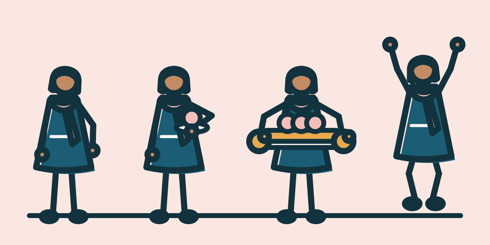 |  |  |
| Arne | 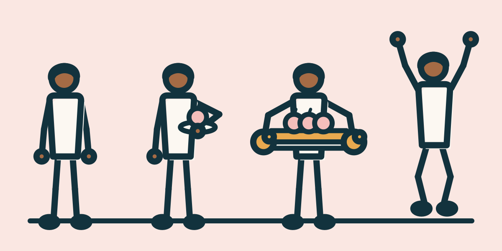 |  |  |

## Ausdrucksposen: Jette und Mats

Von links nach rechts: staunt, freut sich, enttäuscht, nachdenklich, neugierig. Emotionen über Haltung statt über Gesichtszüge. Die Posen sind Daten im Rig (`poses.ts`, `rig-daten.json`); es wird nichts animiert.

**Jette**

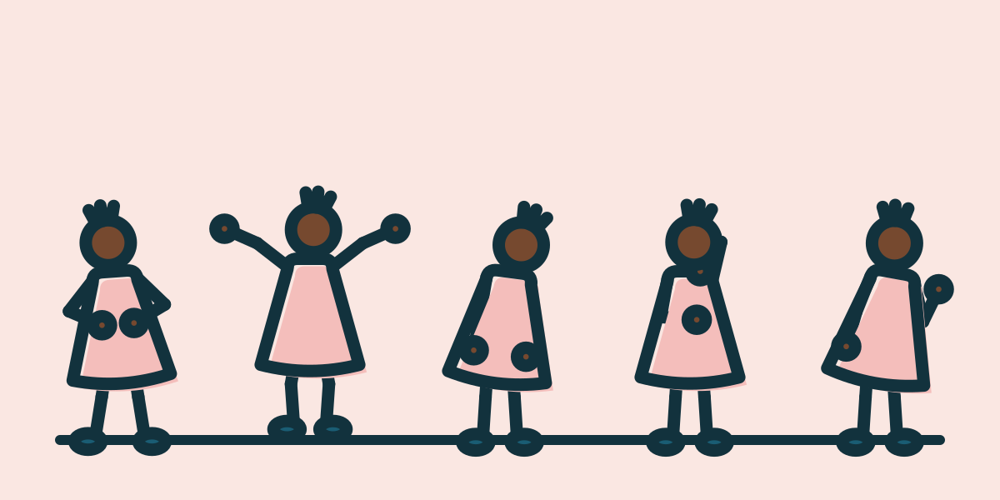 

**Mats**

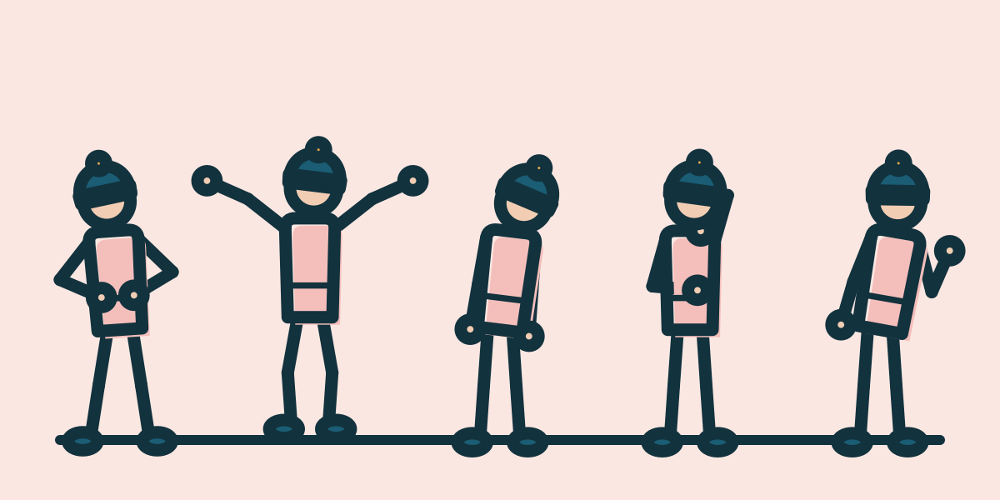 

## Tiere

**Stups** (Vogel, Hauptfigur, Begleiter) hat sechs Posen: steht, sitzt, hüpft, sitzt auf der Schulter, zeigt, schaut zu. **Tüpfel** (Katze, Cameo) hat drei: steht, sitzt, schaut zu. **Regel:** Tiere erscheinen nie in Szenen mit Backofen, Herd, heißen Gegenständen, Messer oder Schere in Benutzung (auch nicht bei Feuer); sie steht im Szenenprüfer.

| Tier | Bild | 96 × 48 | 64 × 32 |
| --- | --- | --- | --- |
| Tüpfel 1 | 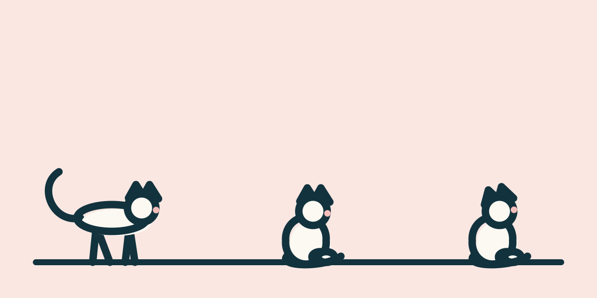 |  |  |
| Stups 1 | 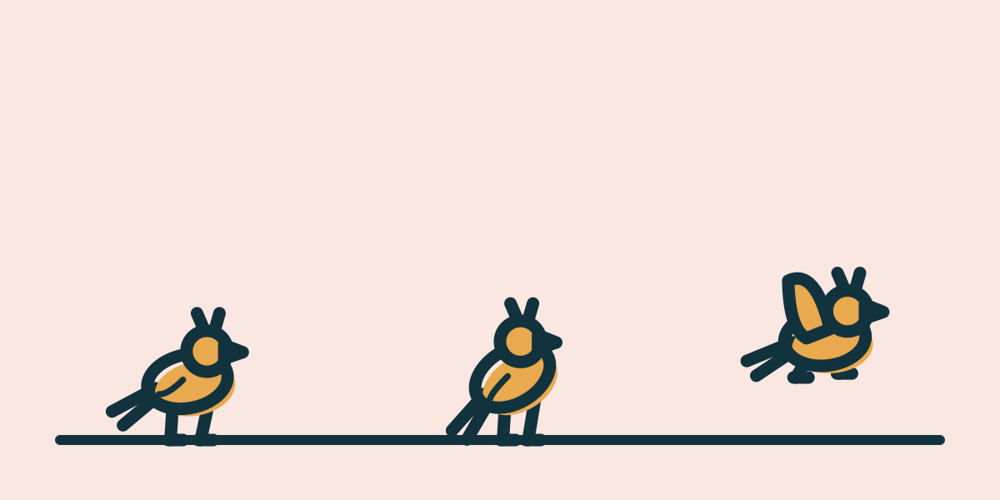 |  |  |
| Stups 2 | 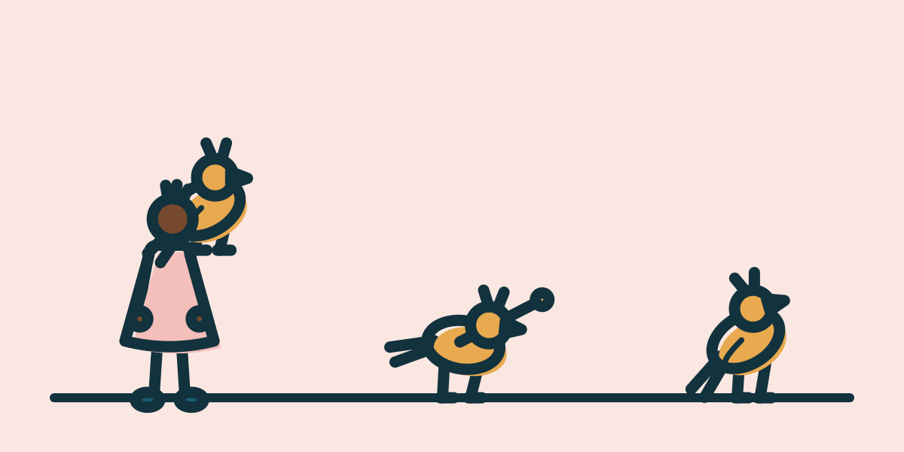 |  |  |

## Familie am Tisch

Mats, Jette, Nolli, Ilka und Arne stehen hinter dem gedeckten Tisch, Tüpfel sitzt davor. Zum Prüfen von Größenverhältnissen und Wiedererkennung. Auf dem Tisch nur ein Teller mit Apfel.

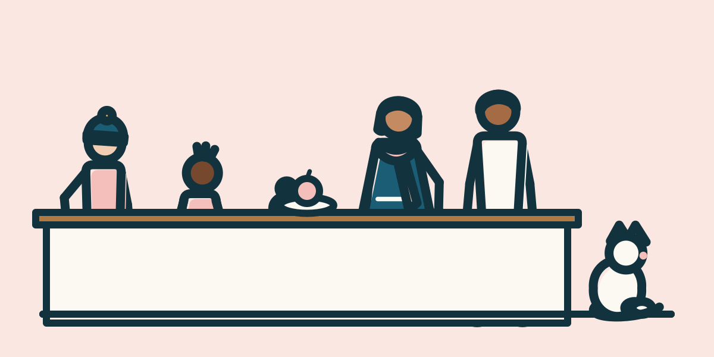 

## Triptychen

Läuft herein, nimmt das Tablett (kalte Kekse), jubelt. **Stups fasst nichts an:** Er hüpft herein, zeigt auf das Tablett und hüpft vor Freude.

**Jette**

| 1. läuft herein | 2. nimmt das Tablett | 3. jubelt |
| --- | --- | --- |
| 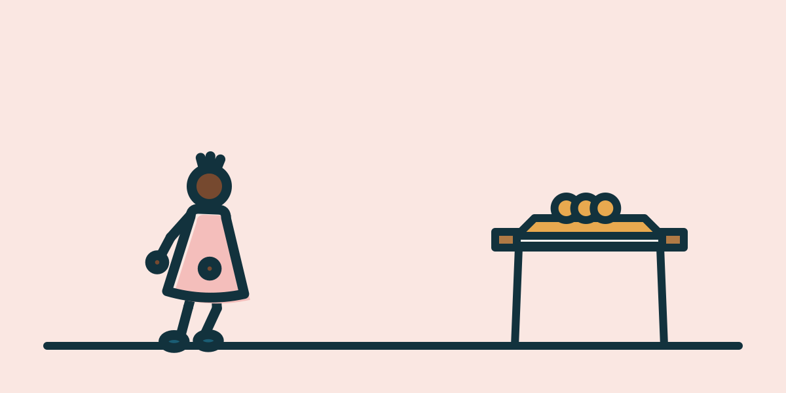 |  | 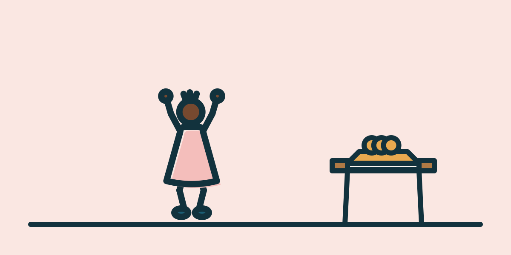 |

**Mats**

| 1. läuft herein | 2. nimmt das Tablett | 3. jubelt |
| --- | --- | --- |
| 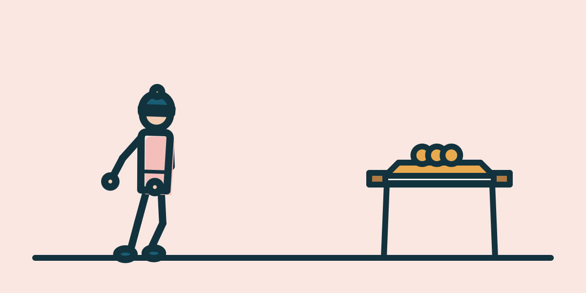 |  | 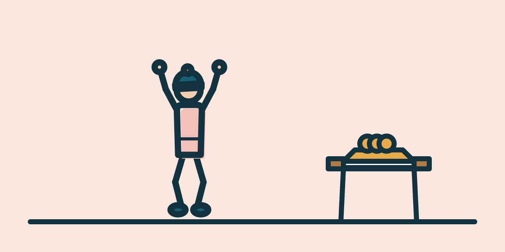 |

**Stups**

| 1. hüpft herein | 2. zeigt auf das Tablett | 3. jubelt |
| --- | --- | --- |
| 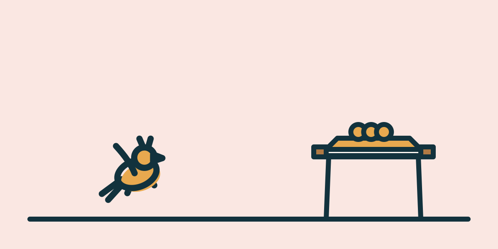 | 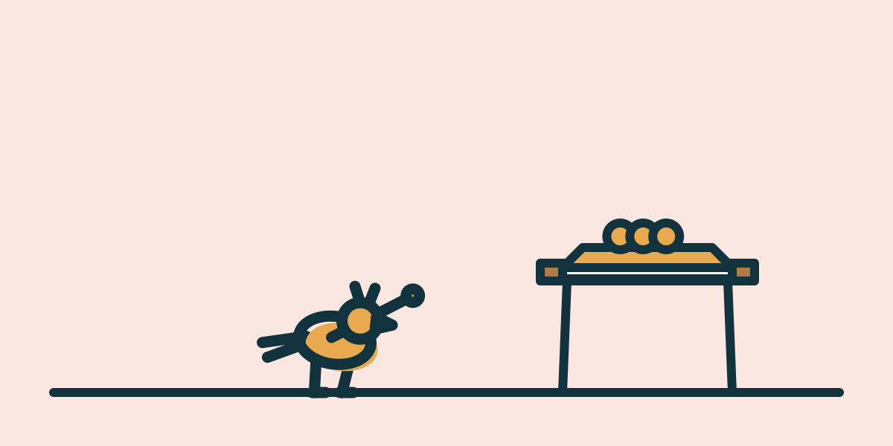 | 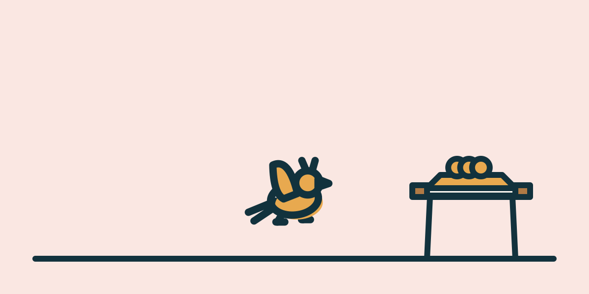 |

## Einheitlichkeit der Linien

Figuren mit Linie 4, 4,5 und 5; die Gegenstände (Tablett, Teller, Tisch) bleiben 4, feine Linien 2,5. Entschieden: **5**.

| Figurenlinie | Familie am Tisch | 96 × 48 | 64 × 32 |
| --- | --- | --- | --- |
| 4 | 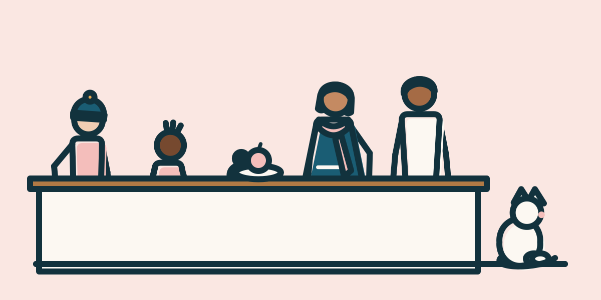 |  |  |
| 4.5 | 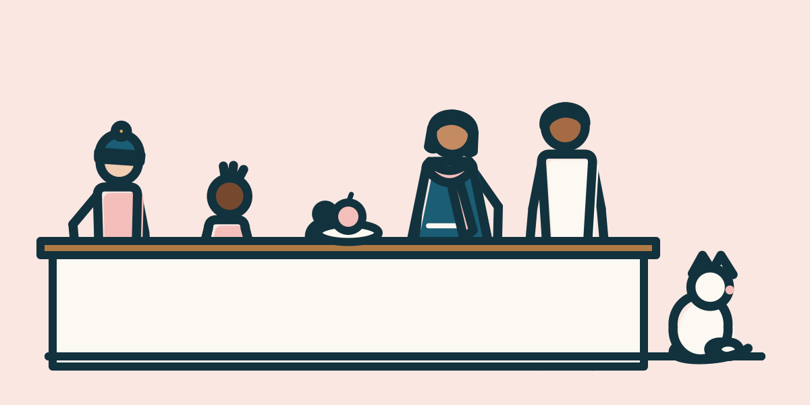 |  |  |
| 5 |  |  |  |

## Dateigrößen (gemessen, Figurenlinie 5)

Grenze für Titel- und Schrittbilder: 14 KB (das Bucket erlaubt 20 KB). Das größte Bild einer **Szene** (Besetzung, Familie, Triptychen) hat 8,8 KB; ein **Figurenblatt** oder Ausdrucksblatt (mehrere Posen, kein Titelbild) höchstens 7,8 KB.

| Datei | Größe |
| --- | --- |
| `vorschau/besetzung.svg` | 8,8 KB |
| `vorschau/nolli.svg` | 6,1 KB |
| `vorschau/jette.svg` | 5,7 KB |
| `vorschau/mats.svg` | 6,5 KB |
| `vorschau/ilka.svg` | 7,8 KB |
| `vorschau/arne.svg` | 6,0 KB |
| `vorschau/jette-ausdruck.svg` | 6,4 KB |
| `vorschau/mats-ausdruck.svg` | 7,4 KB |
| `vorschau/tuepfel-1.svg` | 2,7 KB |
| `vorschau/stups-1.svg` | 3,1 KB |
| `vorschau/stups-2.svg` | 4,5 KB |
| `vorschau/familie.svg` | 8,2 KB |
| `vorschau/jette-tri1.svg` | 2,0 KB |
| `vorschau/jette-tri2.svg` | 2,0 KB |
| `vorschau/jette-tri3.svg` | 1,9 KB |
| `vorschau/mats-tri1.svg` | 2,1 KB |
| `vorschau/mats-tri2.svg` | 2,2 KB |
| `vorschau/mats-tri3.svg` | 2,2 KB |
| `vorschau/stups-tri1.svg` | 1,6 KB |
| `vorschau/stups-tri2.svg` | 1,8 KB |
| `vorschau/stups-tri3.svg` | 1,6 KB |
| `vorschau/linie-4.svg` | 8,2 KB |
| `vorschau/linie-4-5.svg` | 8,4 KB |
| `vorschau/linie-5.svg` | 8,2 KB |

