# Figuren: drei Sätze zur Auswahl (Entwurf)

> **ERZEUGT** von `npm run figures:preview` aus `scripts/lib/figures/`. Nicht von Hand ändern. Hintergrund, Regeln und offene Entscheidungen: [`docs/design/FIGUREN.md`](../FIGUREN.md).

Drei Figurensätze mit deutlich anderer Anmutung, je ein größeres Kind, ein kleineres Kind, ein Erwachsener und ein Haustier. Jeder Satz in **zwei Fassungen aus demselben Rig**: ohne Gesichtszüge (wie bisher) und mit zwei Punkten als Augen (sonst nichts).
Karten sind 2:1 (Kartengröße 312 px breit gezeigt), daneben die Daumennägel 96 × 48 und 64 × 32. **Prüfung für ein Maskottchen:** Kannst du dir Name und Figur auf einem T-Shirt oder in einem 5-Sekunden-Clip vorstellen?

## Überblick

| Satz | ohne Gesichtszüge | mit Augenpunkten |
| --- | --- | --- |
| **Satz A: rund und weich** | 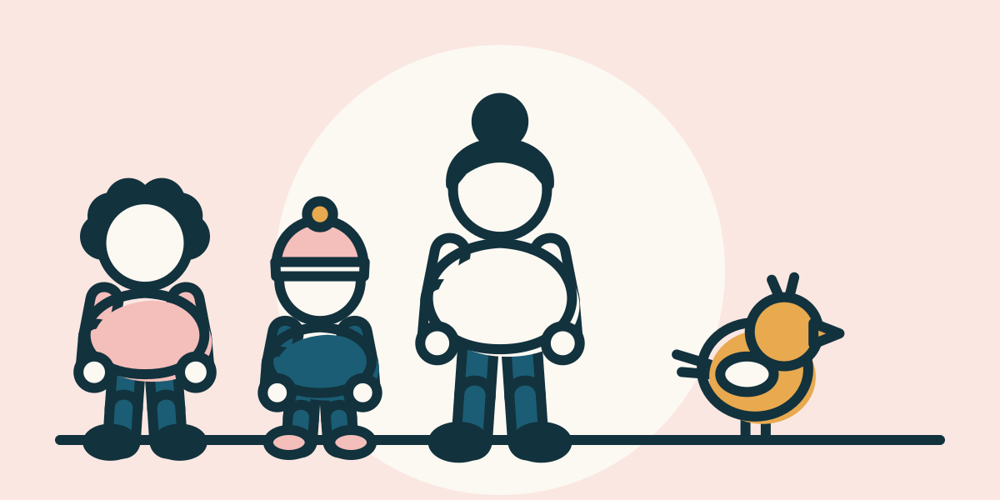 |  |
| **Satz B: eckig und kräftig** | 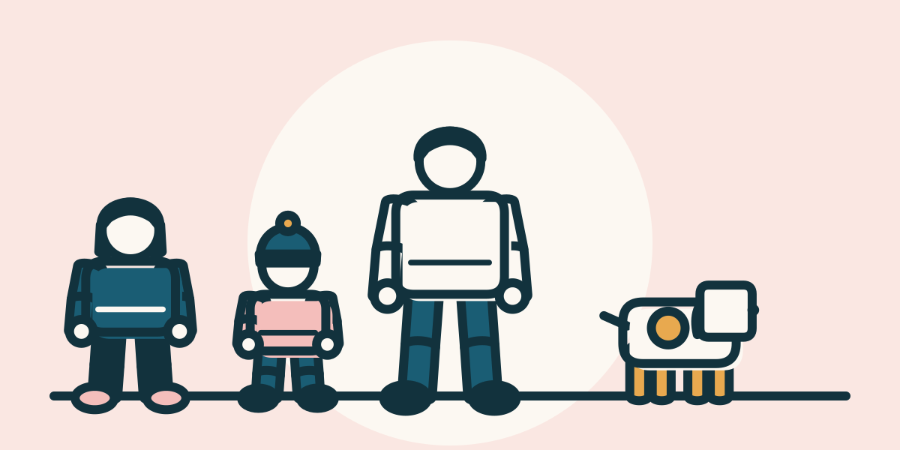 | 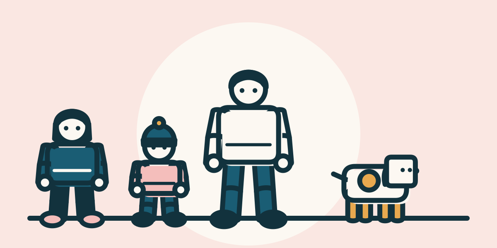 |
| **Satz C: schlank und verspielt** |  | 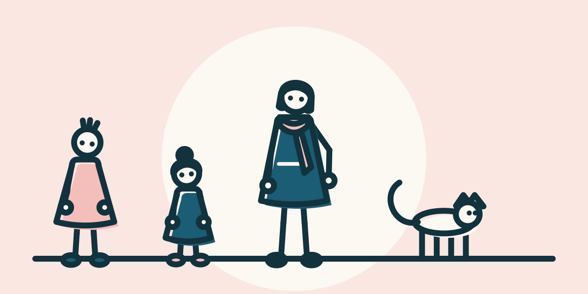 |

## Satz A: rund und weich

Knubbelig: große runde Köpfe, kurze dicke Arme und Beine, eiförmige Rümpfe, Locken und Mützchen. Wirkt wie ein Kuscheltier.

| Name | Rolle | Beschreibung | Namenscheck (Kinderfiguren, Websuche) |
| --- | --- | --- | --- |
| **Joni** | größeres Kind | das größere Kind: Locken, rosa Pulli | keine bekannte Kinderfigur gefunden |
| **Fenn** | kleineres Kind | das kleinere Kind: Mützchen, Petrol-Overall | keine Kinderfigur gefunden (nur Buchreihe „Fenn Halflin“ für 9 bis 12, kein Vorschulbezug) |
| **Sanne** | Erwachsener | der Erwachsene: Dutt, Leinen-Pulli mit Petrol-Hose | keine bekannte Kinderfigur gefunden |
| **Stups** | Haustier | ein rundes Küken | keine bekannte Kinderfigur gefunden (Igel gibt es viele, deshalb ein Küken) |

### Figurenblätter: stehen, hält etwas, trägt Tablett, jubelt

Von links nach rechts: stehen, hält einen Teller mit Apfel, trägt ein Tablett (der Erwachsene mit Ofenhandschuhen und Äpfeln, die Kinder mit Keksen), jubelt (Haustier: steht, läuft, hüpft, schnuppert). Menschen von vorn, Haustier von der Seite.

| Figur | Karte | 96 × 48 | 64 × 32 |
| --- | --- | --- | --- |
| Joni (ohne) | 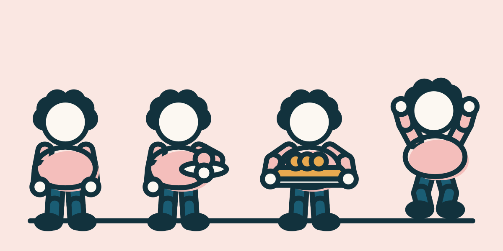 |  |  |
| Fenn (ohne) | 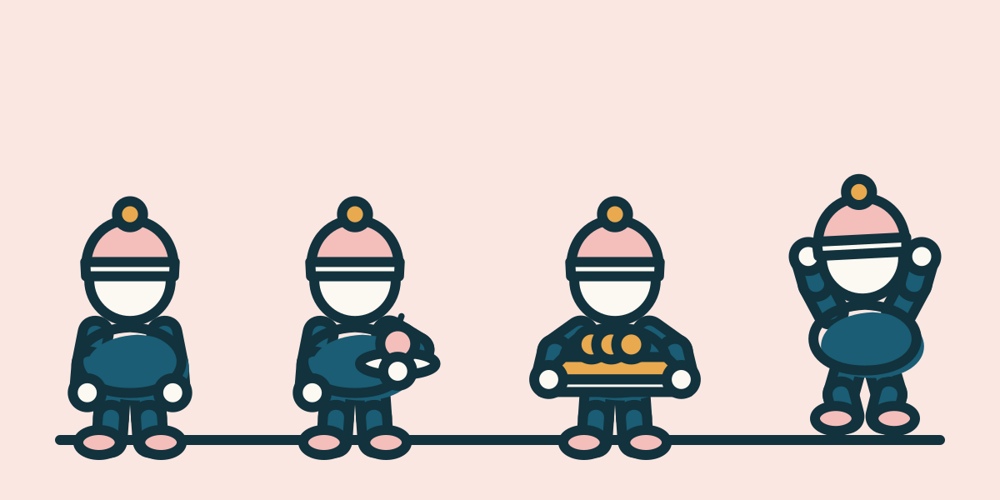 |  |  |
| Sanne (ohne) | 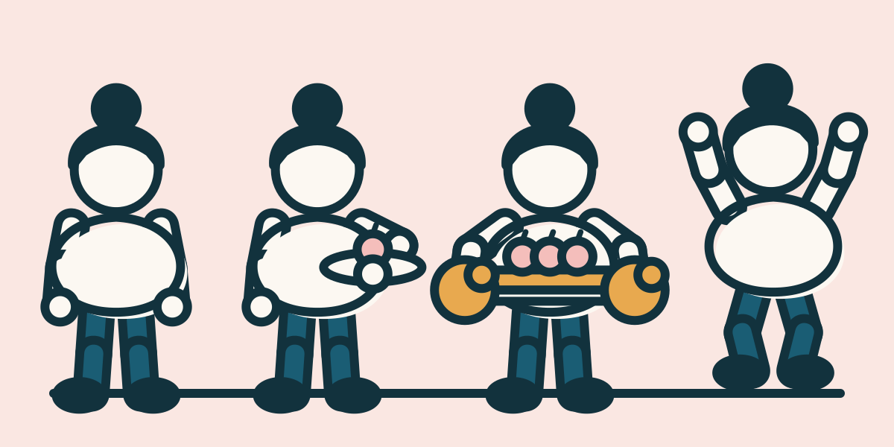 |  |  |
| Stups (ohne) | 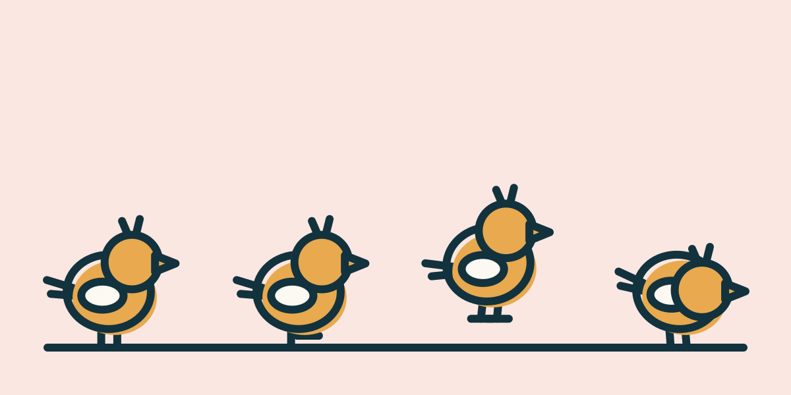 |  |  |
| Joni (mit Augen) | 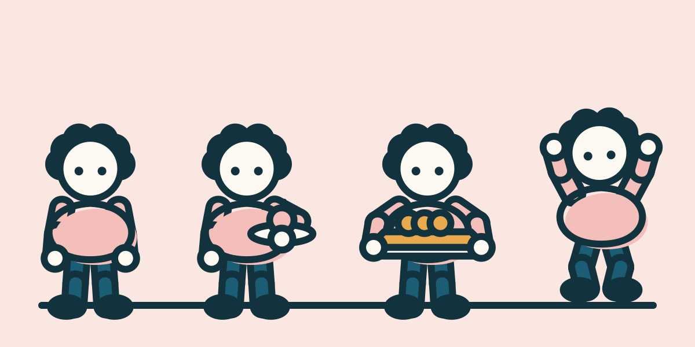 |  |  |
| Fenn (mit Augen) |  |  |  |
| Sanne (mit Augen) |  |  |  |
| Stups (mit Augen) | 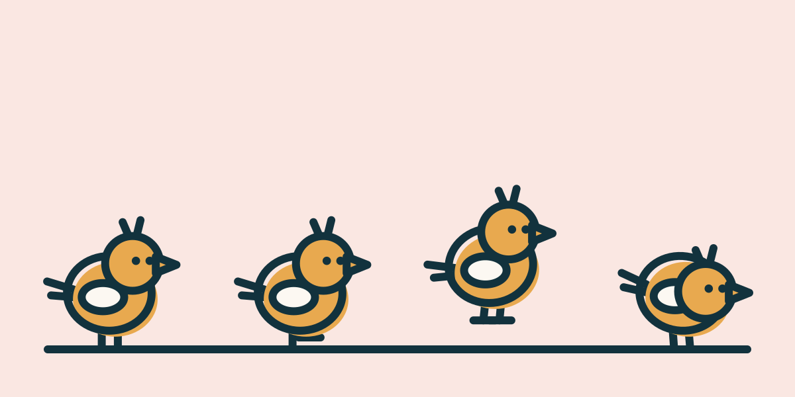 |  |  |

### Triptychon: läuft herein, nimmt das Tablett, alle jubeln

**ohne Gesichtszüge**

| 1. läuft herein | 2. nimmt das Tablett | 3. jubeln |
| --- | --- | --- |
| 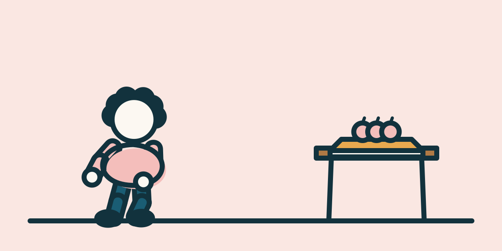 | 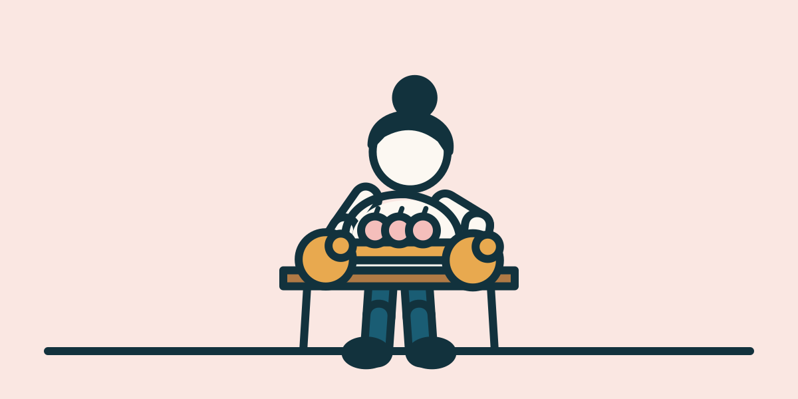 | 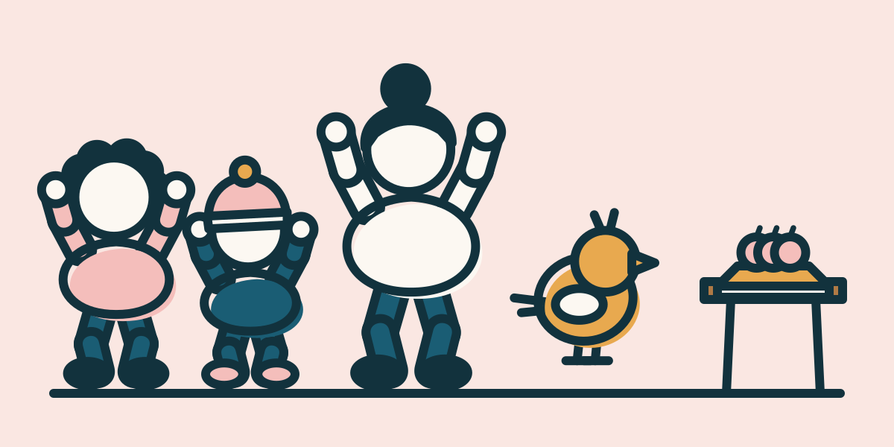 |
|   |   |   |

**mit Augenpunkten**

| 1. läuft herein | 2. nimmt das Tablett | 3. jubeln |
| --- | --- | --- |
| 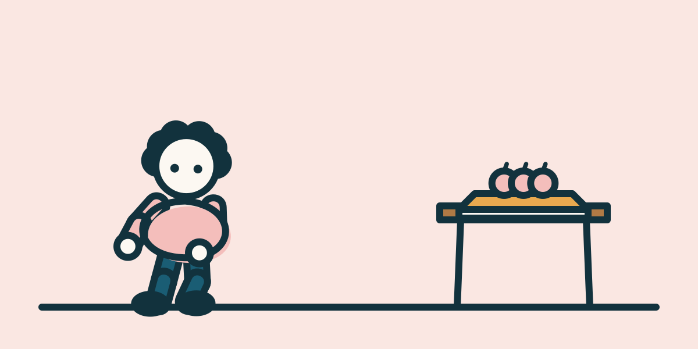 |  |  |
|   |   |   |

## Satz B: eckig und kräftig

Handfest: Kasten-Rümpfe, breite Schultern, dicke Glieder mit kleinen Ecken, Stiefel, Mützen. Wirkt wie Spielzeug aus Holz.

| Name | Rolle | Beschreibung | Namenscheck (Kinderfiguren, Websuche) |
| --- | --- | --- | --- |
| **Bent** | größeres Kind | das größere Kind: Bob-Haar, Petrol-Jacke mit Gürtel | keine bekannte Kinderfigur gefunden |
| **Fidi** | kleineres Kind | das kleinere Kind: Beanie mit Bommel, Rosé-Pullover | keine bekannte Kinderfigur gefunden |
| **Hanne** | Erwachsener | der Erwachsene: breit und stark, Leinen-Pulli, Gürtel | keine bekannte Kinderfigur gefunden |
| **Mutz** | Haustier | ein kräftiger Hund mit Fleck | keine bekannte Kinderfigur gefunden |

### Figurenblätter: stehen, hält etwas, trägt Tablett, jubelt

Von links nach rechts: stehen, hält einen Teller mit Apfel, trägt ein Tablett (der Erwachsene mit Ofenhandschuhen und Äpfeln, die Kinder mit Keksen), jubelt (Haustier: steht, läuft, hüpft, schnuppert). Menschen von vorn, Haustier von der Seite.

| Figur | Karte | 96 × 48 | 64 × 32 |
| --- | --- | --- | --- |
| Bent (ohne) |  |  |  |
| Fidi (ohne) |  |  |  |
| Hanne (ohne) | 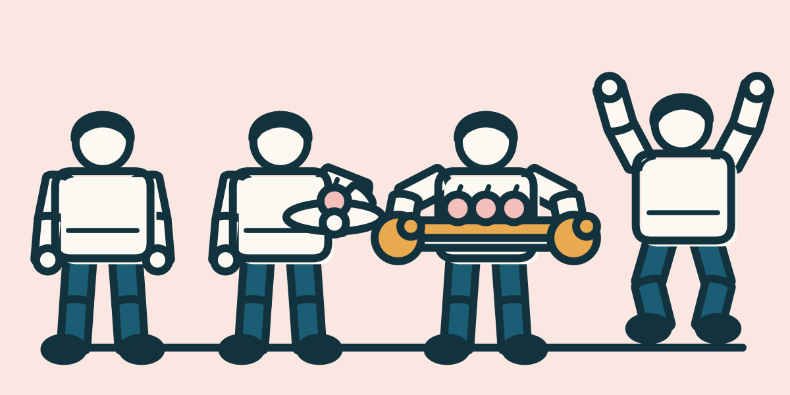 |  |  |
| Mutz (ohne) | 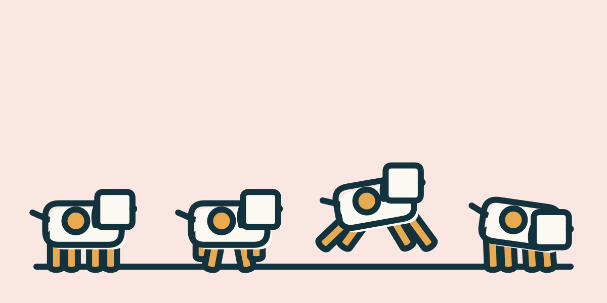 |  |  |
| Bent (mit Augen) | 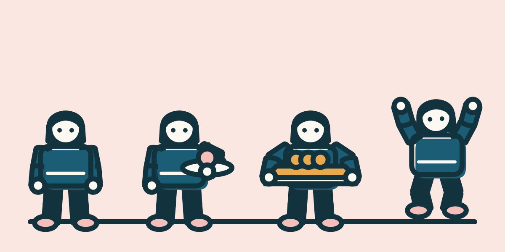 |  |  |
| Fidi (mit Augen) | 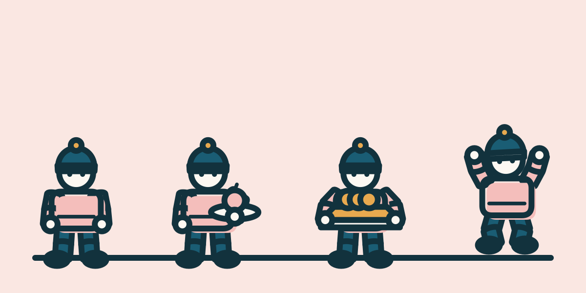 |  |  |
| Hanne (mit Augen) | 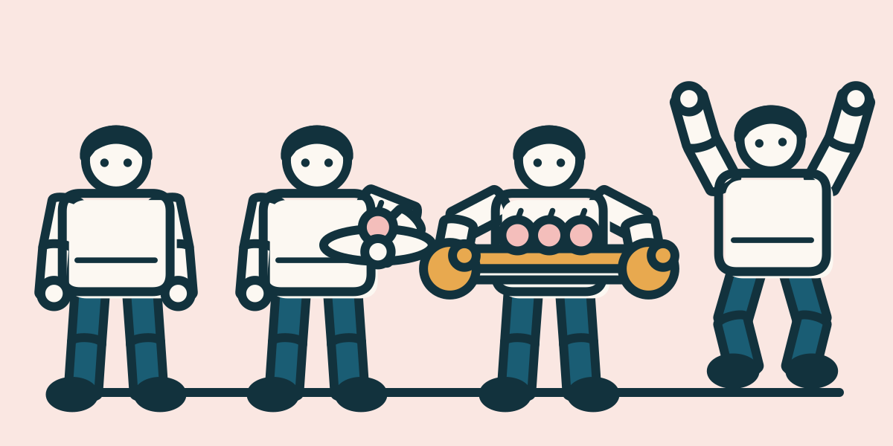 |  |  |
| Mutz (mit Augen) | 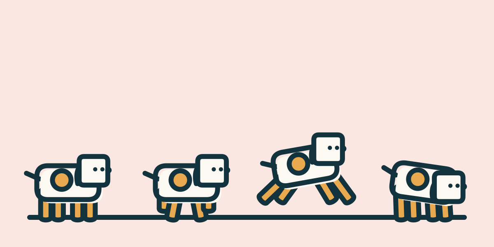 |  |  |

### Triptychon: läuft herein, nimmt das Tablett, alle jubeln

**ohne Gesichtszüge**

| 1. läuft herein | 2. nimmt das Tablett | 3. jubeln |
| --- | --- | --- |
| 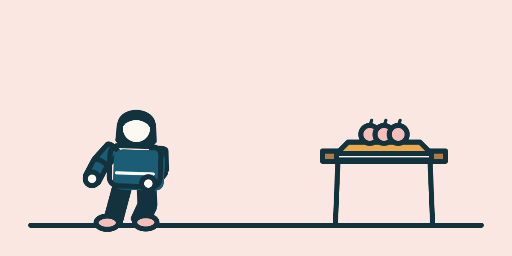 |  | 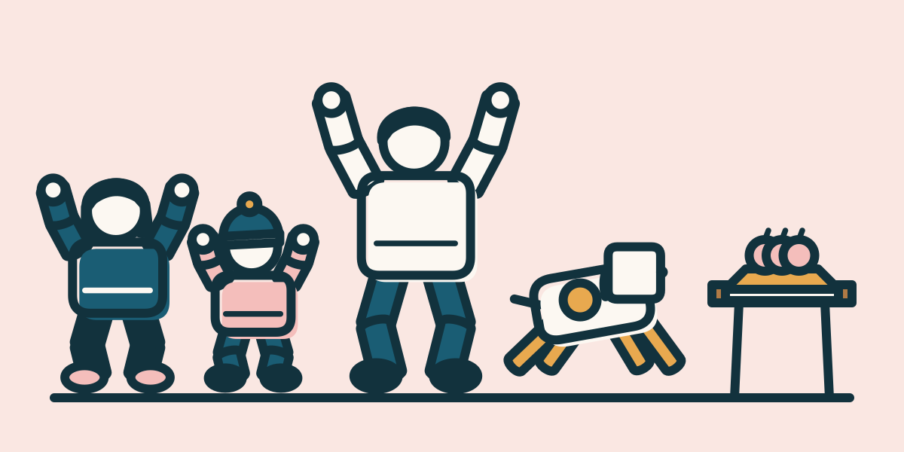 |
|   |   |   |

**mit Augenpunkten**

| 1. läuft herein | 2. nimmt das Tablett | 3. jubeln |
| --- | --- | --- |
| 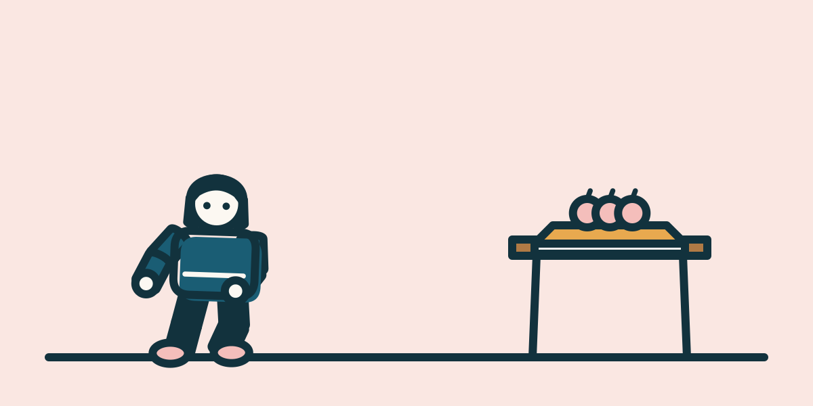 | 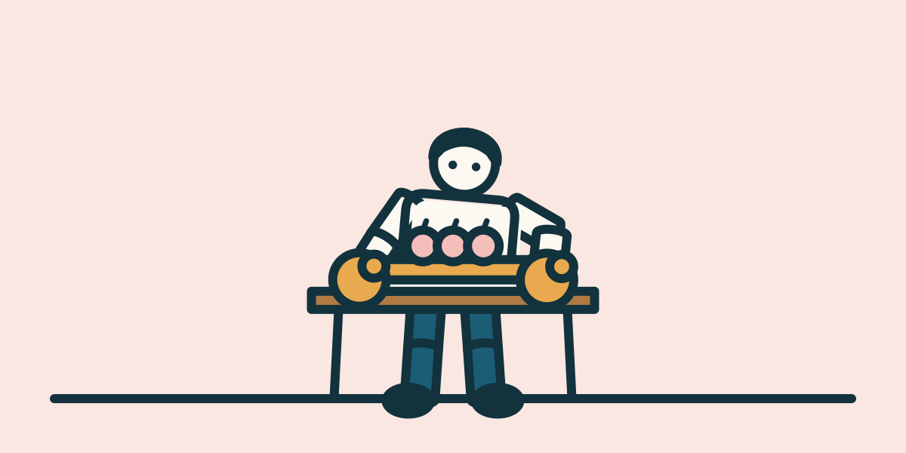 | 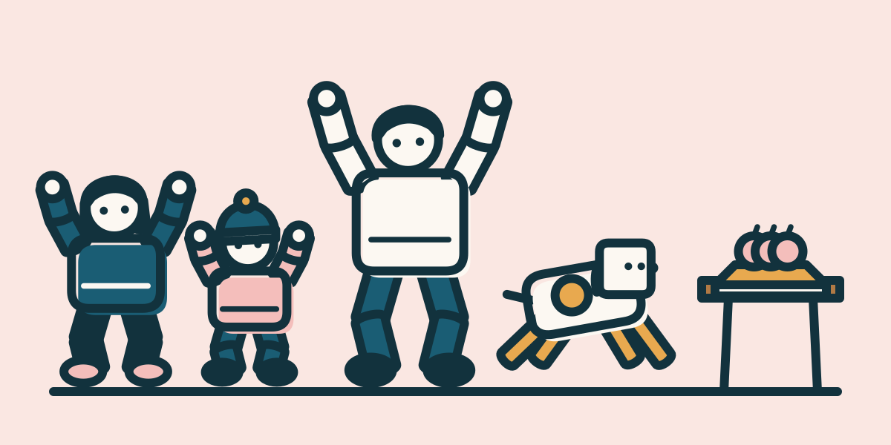 |
|   |   |   |

## Satz C: schlank und verspielt

Luftig: lange dünne Linien-Glieder, kleine Köpfe, Kleid, Schal, Haarbüschel, schiefer Kopf. Wirkt wie eine Zeichnung im Skizzenbuch.

| Name | Rolle | Beschreibung | Namenscheck (Kinderfiguren, Websuche) |
| --- | --- | --- | --- |
| **Jette** | größeres Kind | das größere Kind: Haarbüschel, Rosé-Kleid | keine bekannte Figur, nur eine Buchreihe „Jette“ von Fee Krämer (Erwachsenen- bis Jugendbuch) |
| **Nolli** | kleineres Kind | das kleinere Kind: Dutt, Petrol-Kleidchen | keine bekannte Kinderfigur gefunden |
| **Ilka** | Erwachsener | der Erwachsene: groß und schlank, langer Mantel, Schal | keine bekannte Kinderfigur gefunden |
| **Tüpfel** | Haustier | eine schlanke Katze mit langem Schwanz | keine bekannte Figur (nur „Tüpfelblatt“ aus Warrior Cats, anderer Name) |

### Figurenblätter: stehen, hält etwas, trägt Tablett, jubelt

Von links nach rechts: stehen, hält einen Teller mit Apfel, trägt ein Tablett (der Erwachsene mit Ofenhandschuhen und Äpfeln, die Kinder mit Keksen), jubelt (Haustier: steht, läuft, hüpft, schnuppert). Menschen von vorn, Haustier von der Seite.

| Figur | Karte | 96 × 48 | 64 × 32 |
| --- | --- | --- | --- |
| Jette (ohne) | 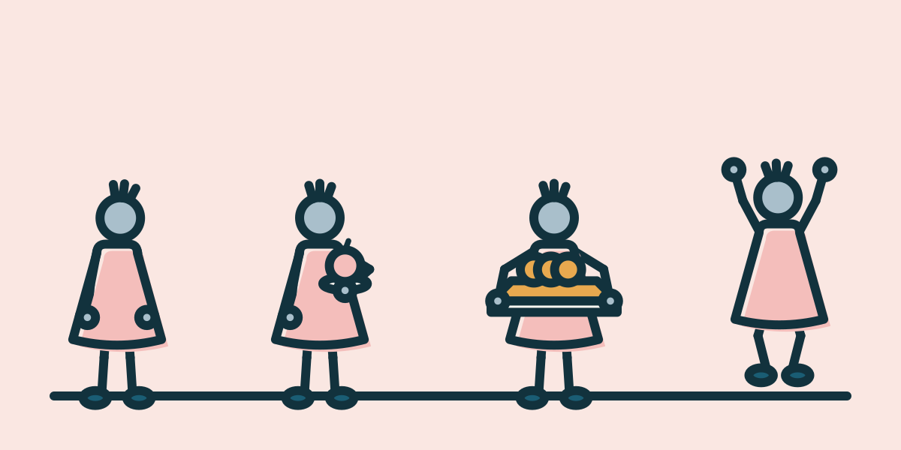 |  |  |
| Nolli (ohne) |  |  |  |
| Ilka (ohne) | 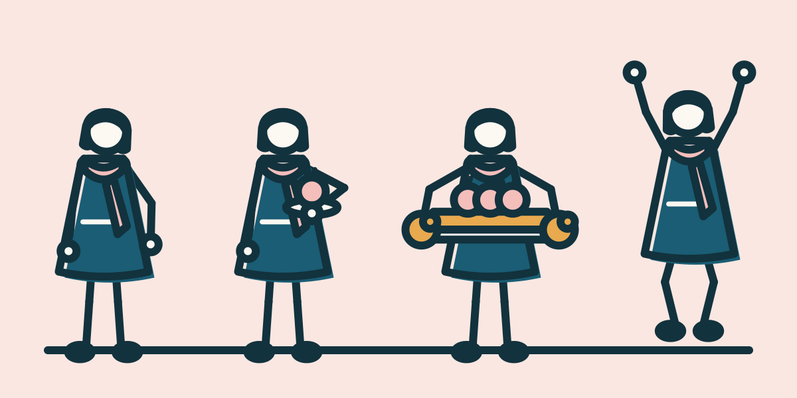 |  |  |
| Tüpfel (ohne) | 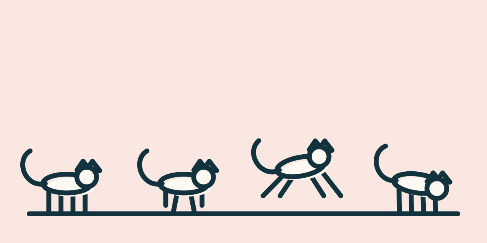 |  |  |
| Jette (mit Augen) |  |  |  |
| Nolli (mit Augen) | 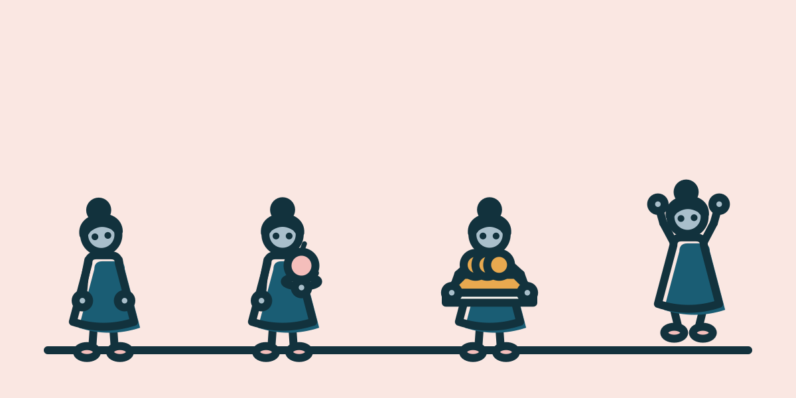 |  |  |
| Ilka (mit Augen) |  |  |  |
| Tüpfel (mit Augen) | 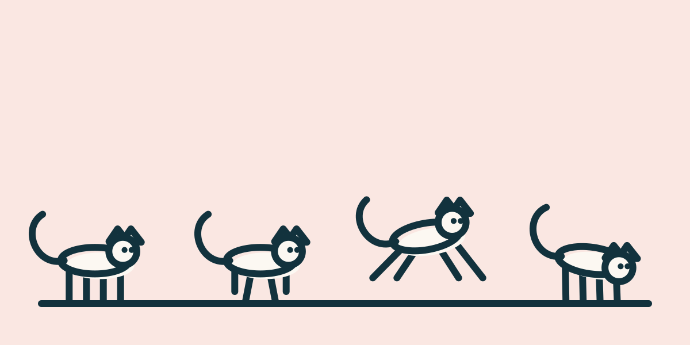 |  |  |

### Triptychon: läuft herein, nimmt das Tablett, alle jubeln

**ohne Gesichtszüge**

| 1. läuft herein | 2. nimmt das Tablett | 3. jubeln |
| --- | --- | --- |
|  | 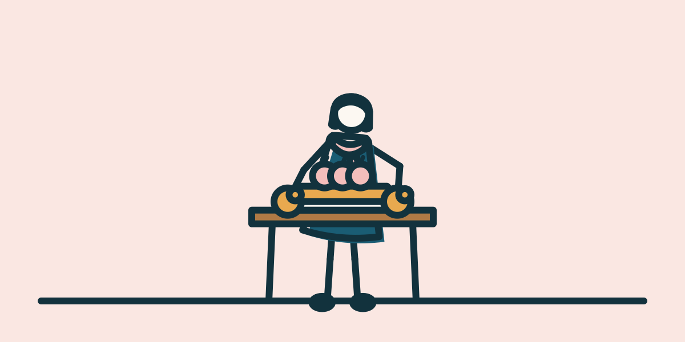 |  |
|   |   |   |

**mit Augenpunkten**

| 1. läuft herein | 2. nimmt das Tablett | 3. jubeln |
| --- | --- | --- |
| 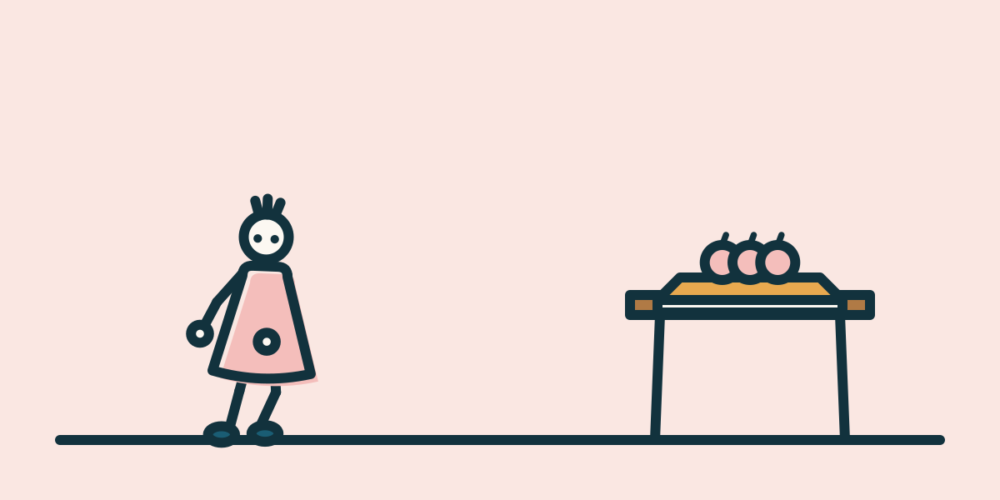 |  | 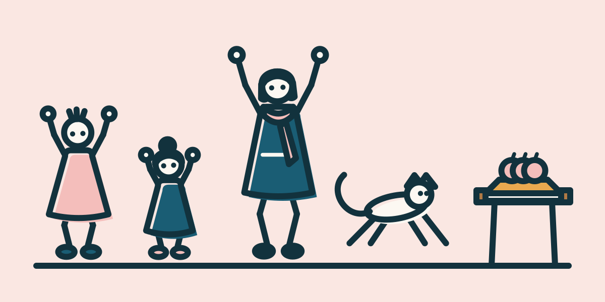 |
|   |   |   |

## Dateigrößen (gemessen)

**Szenenbilder** (Gruppenbild, Triptychon) bleiben unter 10 KB, der Grenze für Titelbilder (die 14 KB für Schrittbilder werden nicht gebraucht): das größte ist 9,2 KB. Ein **Figurenblatt** zeigt vier Posen einer Figur in einem Bild und ist deshalb größer (das größte 10,1 KB); es ist kein Titelbild.

| Datei | Größe | Art |
| --- | --- | --- |
| `vorschau/A-ohne-gruppe.svg` | 7,4 KB | Szene |
| `vorschau/A-augen-gruppe.svg` | 7,9 KB | Szene |
| `vorschau/B-ohne-gruppe.svg` | 8,2 KB | Szene |
| `vorschau/B-augen-gruppe.svg` | 8,7 KB | Szene |
| `vorschau/C-ohne-gruppe.svg` | 5,5 KB | Szene |
| `vorschau/C-augen-gruppe.svg` | 6,0 KB | Szene |
| `vorschau/A-ohne-joni.svg` | 9,4 KB | Figurenblatt |
| `vorschau/A-ohne-fenn.svg` | 8,8 KB | Figurenblatt |
| `vorschau/A-ohne-sanne.svg` | 8,7 KB | Figurenblatt |
| `vorschau/A-ohne-stups.svg` | 4,2 KB | Figurenblatt |
| `vorschau/A-augen-joni.svg` | 9,9 KB | Figurenblatt |
| `vorschau/A-augen-fenn.svg` | 9,3 KB | Figurenblatt |
| `vorschau/A-augen-sanne.svg` | 9,3 KB | Figurenblatt |
| `vorschau/A-augen-stups.svg` | 4,7 KB | Figurenblatt |
| `vorschau/A-ohne-tri1.svg` | 3,0 KB | Szene |
| `vorschau/A-ohne-tri2.svg` | 3,0 KB | Szene |
| `vorschau/A-ohne-tri3.svg` | 7,8 KB | Szene |
| `vorschau/A-augen-tri1.svg` | 3,2 KB | Szene |
| `vorschau/A-augen-tri2.svg` | 3,1 KB | Szene |
| `vorschau/A-augen-tri3.svg` | 8,4 KB | Szene |
| `vorschau/B-ohne-bent.svg` | 9,6 KB | Figurenblatt |
| `vorschau/B-ohne-fidi.svg` | 9,6 KB | Figurenblatt |
| `vorschau/B-ohne-hanne.svg` | 9,4 KB | Figurenblatt |
| `vorschau/B-ohne-mutz.svg` | 6,0 KB | Figurenblatt |
| `vorschau/B-augen-bent.svg` | 10,1 KB | Figurenblatt |
| `vorschau/B-augen-fidi.svg` | 10,1 KB | Figurenblatt |
| `vorschau/B-augen-hanne.svg` | 9,9 KB | Figurenblatt |
| `vorschau/B-augen-mutz.svg` | 6,5 KB | Figurenblatt |
| `vorschau/B-ohne-tri1.svg` | 3,1 KB | Szene |
| `vorschau/B-ohne-tri2.svg` | 3,2 KB | Szene |
| `vorschau/B-ohne-tri3.svg` | 8,7 KB | Szene |
| `vorschau/B-augen-tri1.svg` | 3,2 KB | Szene |
| `vorschau/B-augen-tri2.svg` | 3,3 KB | Szene |
| `vorschau/B-augen-tri3.svg` | 9,2 KB | Szene |
| `vorschau/C-ohne-jette.svg` | 5,7 KB | Figurenblatt |
| `vorschau/C-ohne-nolli.svg` | 6,1 KB | Figurenblatt |
| `vorschau/C-ohne-ilka.svg` | 7,8 KB | Figurenblatt |
| `vorschau/C-ohne-tuepfel.svg` | 4,0 KB | Figurenblatt |
| `vorschau/C-augen-jette.svg` | 6,2 KB | Figurenblatt |
| `vorschau/C-augen-nolli.svg` | 6,7 KB | Figurenblatt |
| `vorschau/C-augen-ilka.svg` | 8,3 KB | Figurenblatt |
| `vorschau/C-augen-tuepfel.svg` | 4,5 KB | Figurenblatt |
| `vorschau/C-ohne-tri1.svg` | 2,1 KB | Szene |
| `vorschau/C-ohne-tri2.svg` | 2,7 KB | Szene |
| `vorschau/C-ohne-tri3.svg` | 6,0 KB | Szene |
| `vorschau/C-augen-tri1.svg` | 2,3 KB | Szene |
| `vorschau/C-augen-tri2.svg` | 2,9 KB | Szene |
| `vorschau/C-augen-tri3.svg` | 6,6 KB | Szene |

