# Farb-Umstellung auf Palette C: Bilder und Sichtprüfung

Stand: 15. Oktober 2026. Die Farben von „Sonntagslicht“ (Terrakotta, Salbei, Honig) sind durch die Palette C ersetzt (DESIGN.md, Entscheidung 55; alle Werte: `docs/theme.md`).
Die Bilder sind mit Chromium (Webausgabe der App, 390 × 844, doppelte Pixeldichte, Deutsch) entstanden.

**Wichtig zu den Bildern (ehrlich):**

- Sie zeigen die Web-Ausgabe der App, **nicht** ein echtes iPhone oder Android-Gerät. Schriften, Schatten und Abstände können dort leicht abweichen.
- **Der Dunkelmodus ist in der App noch ausgeschaltet** (bis D5). Für die Bilder „dunkel“ wurde er nur für den Bildbau von Hand eingeschaltet und danach wieder zurückgestellt. Bildschirme, die noch den festen hellen `colors`-Export nutzen
  (Verlauf, Kinderprofile, „Wie war’s?“), sind darin nicht enthalten.
- **Ergebnis** und **Ortsseite** sind aus den echten Bausteinen zusammengesetzt (`ResultsHeader`, `WeatherBar`, `SuggestionCard`, `PlaceDetails`, `Button`), nicht über die echten Routen: Das Wetter und die Orte kommen im Netz, das hier nicht erreichbar ist.
  Die **Detailansicht** ist die echte Route (`/activity/sock-puppet-theater`). Die Seite für den Bildbau (`app/preview.tsx`) ist nicht eingecheckt.
- **Nicht zu sehen:** App-Icon, adaptives Android-Icon und Startbild. Sie erscheinen erst in einem echten Build, nicht in Expo Go und nicht im Browser.

## Zeichnungen: vorher und nachher

Nur die Farben sind geändert, nichts ist neu gezeichnet. Links Sonntagslicht, rechts Palette C (Vorlagen mit Farbplätzen, damals `npm run illustrations:build`; die Pilot-Zeichnungen und der Befehl sind seit M9b entfernt, alle Bilder kommen aus Supabase).

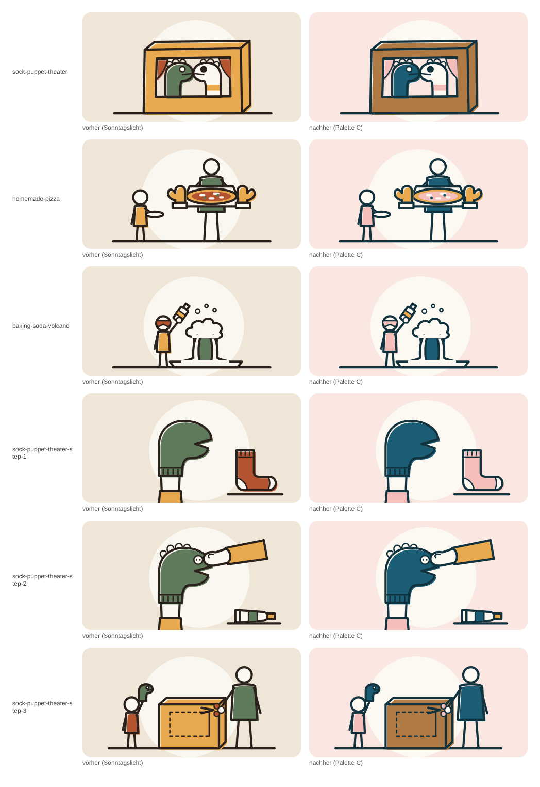

## Start

| Hell | Dunkel |
| --- | --- |
| 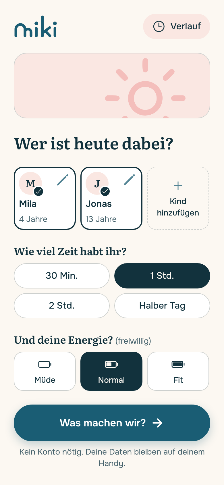 | 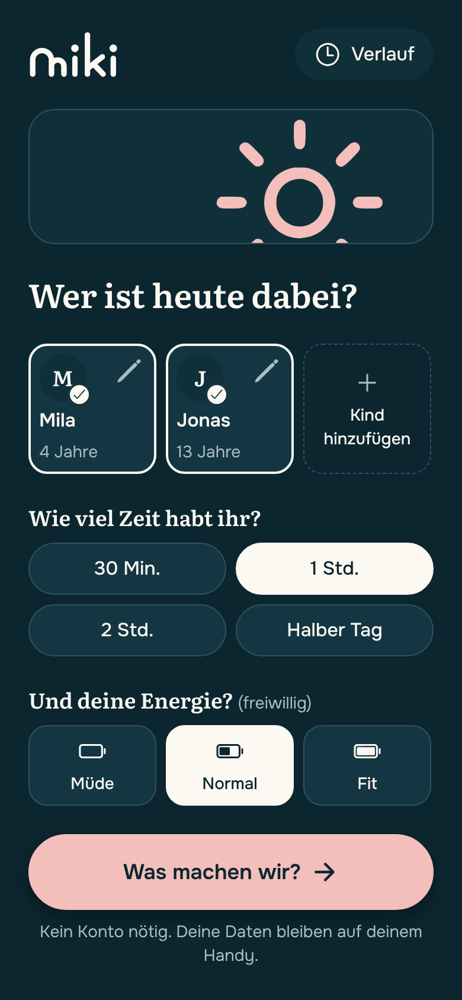 |

Die Wortmarke ersetzt den Text „miki“ (Petrol auf Leinen, im Dunkeln die Leinen-Datei).

## Ergebnis (drei Karten: Zeichnung, Farbfläche, Zeichnung)

| Hell | Dunkel |
| --- | --- |
| 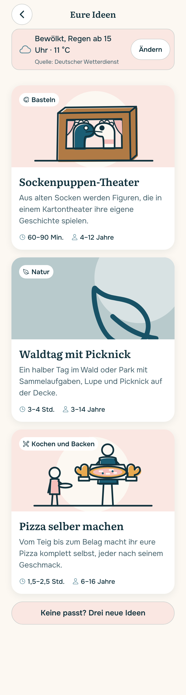 | 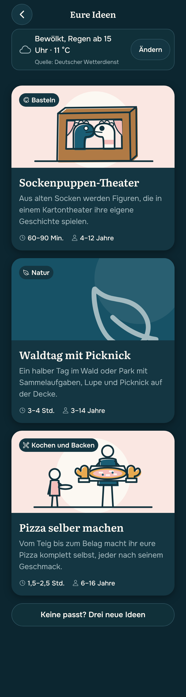 |

Sockenpuppen-Theater und Pizza zeigen eine Zeichnung, „Waldtag mit Picknick“ die Farbfläche (Natur) mit großem Symbol.

## Detailansicht „Sockenpuppen-Theater“

| Hell | Dunkel |
| --- | --- |
| 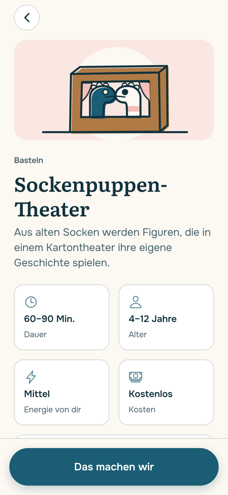 | 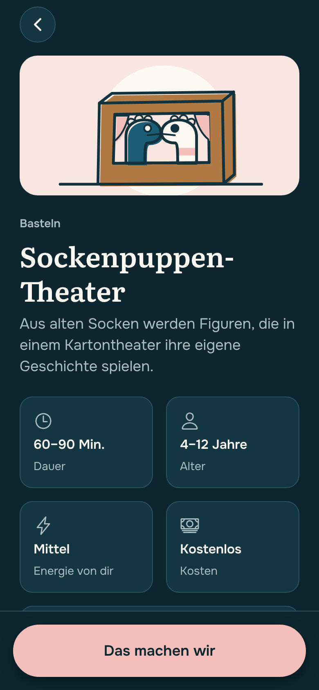 |

## Ortsseite

| Hell | Dunkel |
| --- | --- |
| 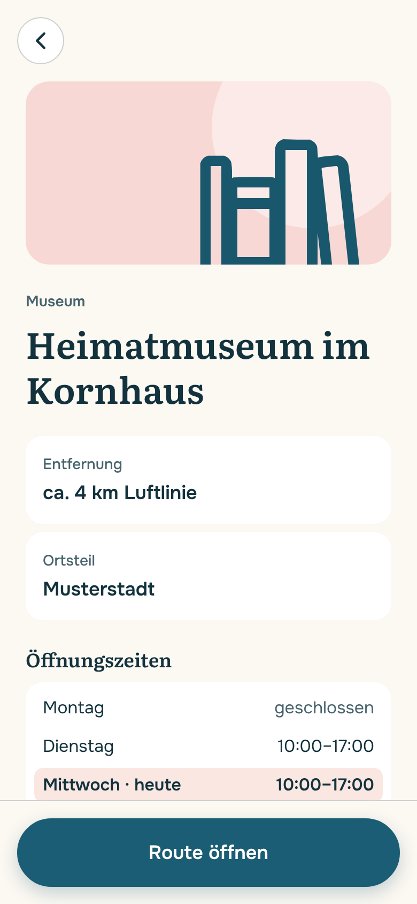 | 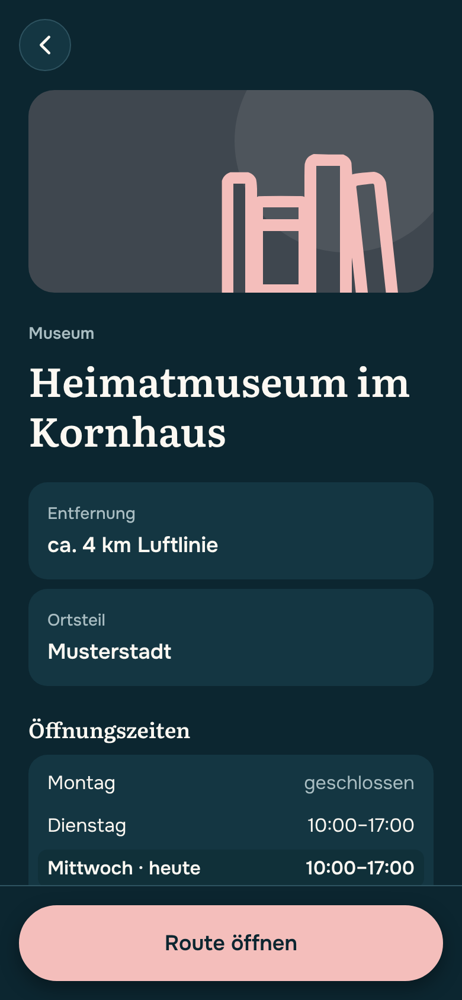 |

## Eine Karte pro Kategorie (Farbfläche mit Symbol)

Basteln, Spiel, Bewegung, Experiment, Natur, Kochen und Ausflug, von oben nach unten.

| Hell | Dunkel |
| --- | --- |
| 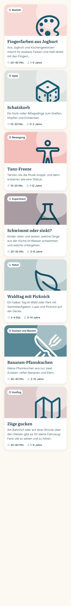 | 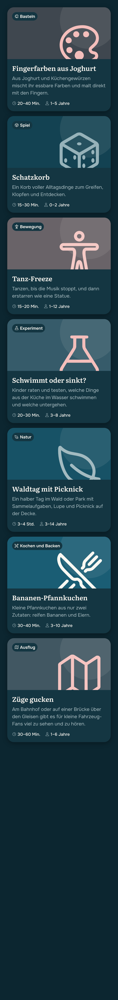 |

## Orte (nehmen den Ton ihrer Kategorie)

Spielplatz (Bewegung), Bad (Natur), Museum (Basteln), Zoo (Ausflug), Burg (Experiment) und weitere.

| Hell | Dunkel |
| --- | --- |
| 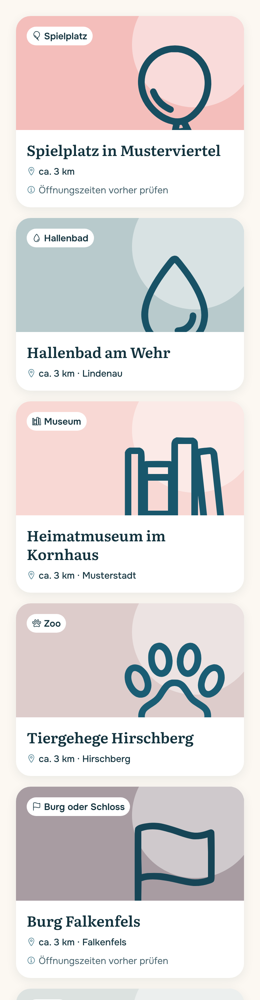 | 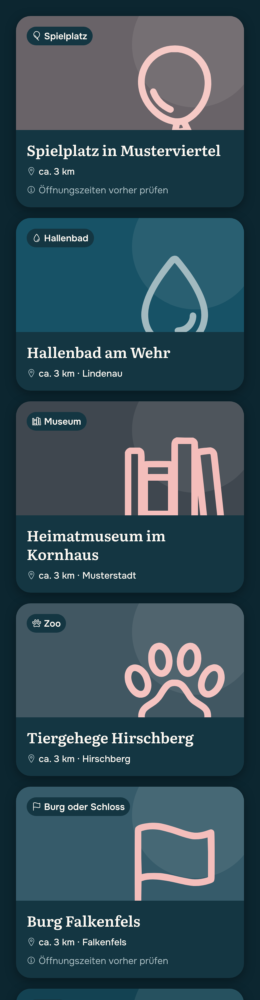 |

## Beurteilung der Sichtprüfung

- **Kategorie-Farben:** Wie vorab gesagt, tragen Symbol und Pille den Unterschied. Auf dem Bild sind Natur, Kochen, Spiel und die Rosé-Töne gut zu trennen. **Basteln (Rosé hell), Ausflug (Rosé-Grau) und Experiment (dunkleres Rosé-Grau)** liegen
  farblich nah beieinander. Das Symbol und der Name in der Pille helfen. Eine zweite Runde mit Menschen (Ani, Eltern) bleibt sinnvoll.
- **Kochen:** Die klare Petrol-Fläche mit Leinen-Symbol hebt sich deutlich ab (im Hellen 3,5:1 für Tinte, dort steht kein Text, siehe `docs/theme.md`).
- **Karten-Schatten (Entscheidung A):** In der Webausgabe setzt der bestehende Schatten die weißen Karten gut vom Leinen-Grund ab, ein zusätzlicher Rand war nicht nötig. **Auf Android ist das nicht geprüft.**
  Wirkt der Schatten dort zu schwach, kommt ein hauchfeiner Rand in einem hellen Petrol-Ton dazu (z. B. `mixColors(Petrol, Weiß, …)` als `borderColor` an `SuggestionCard`, `PlaceCard`, `FactTiles`).
- **Rosé-Flächen:** `surface` hat auf Leinen nur 1,1:1. Die Wetterzeile, die Hinweisflächen, der Stimmungsstreifen und die Karten im Verlauf haben deshalb einen feinen Rand (`border`), die Warnboxen einen Rand in `warning`.
  Der gewählte Tag in der Öffnungszeiten-Liste (Rosé, fett, „· heute“) steht ohne Rand: Die Farbe ist dort nie das einzige Merkmal.
- **Zeichnungen:** Rosé-Sauce und Rosé-Kleidung wirken gedämpfter als Terrakotta, bleiben aber lesbar; Honig für Teig und Handschuhe, Braun für die Pappe. **Auf Petrol-Flächen verschwindet der Tinten-Umriss (1,8:1),** die Formen
  tragen sich über die Fläche (Puppen, Hemd des Erwachsenen). Das ist ein Preis der Palette; vor der Beta schaut ein Mensch alle Zeichnungen durch.
- **Dunkel:** Zeichnungen bleiben hell und stehen wie Fotos auf der dunklen Karte (Regel in `ILLUSTRATIONEN.md`). Der Hauptknopf ist Rosé mit dunkler Schrift (9,7:1).
