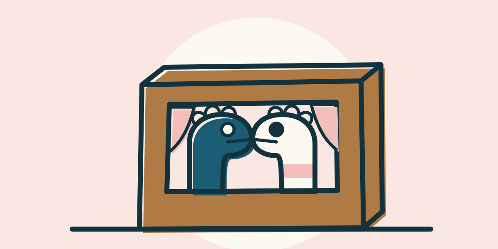
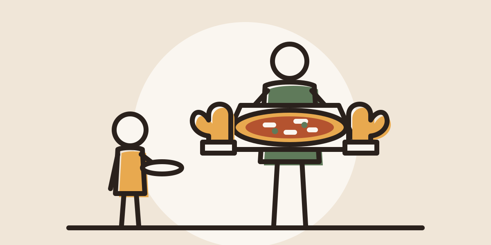
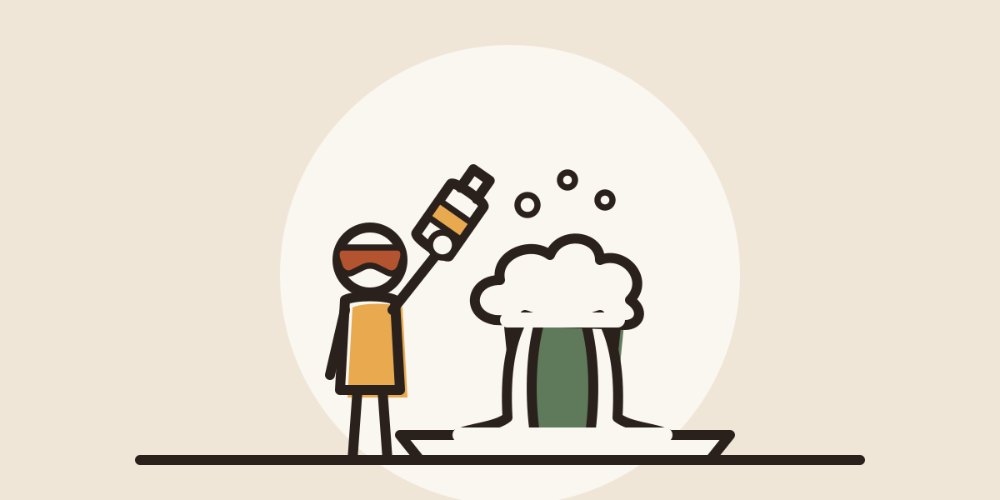
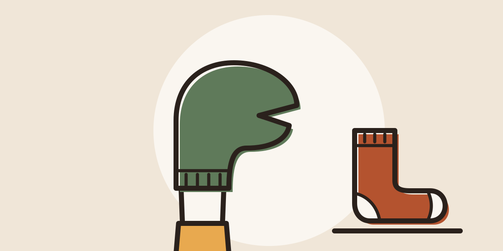
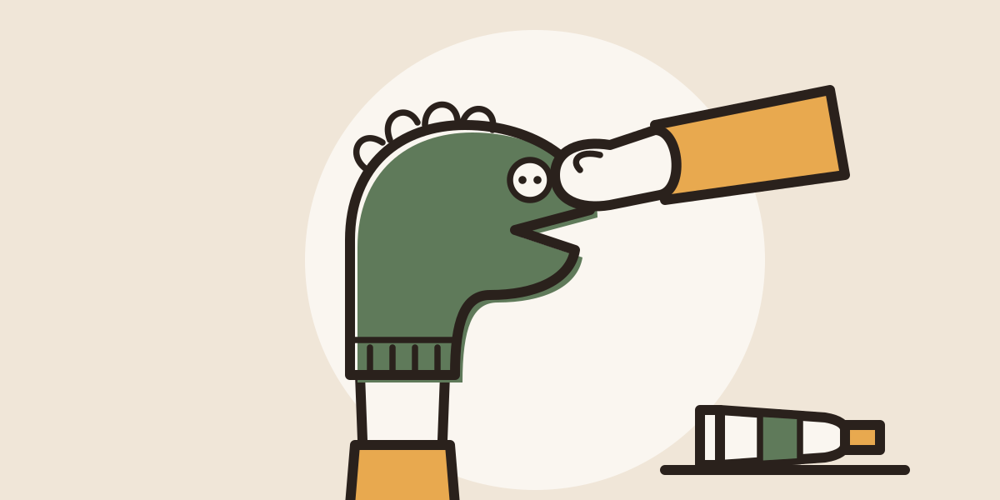
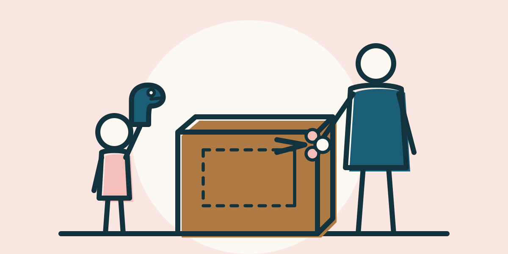

# Pilot: Illustrationen statt Farbfläche

Stand: 13. Oktober 2026. **Pilot, nichts davon ist endgültig.** Wir testen an drei Aktivitäten, ob ein selbst gezeichneter Stil
zu „Sonntagslicht“ passt. Stilregeln: `docs/design/ILLUSTRATIONEN.md`. Gezeichnet von Claude Code als SVG (Code), ohne fremde Bilder als Vorlage.
Deshalb gibt es für sie keine Quellenliste (fremde Fotos gibt es in der App nicht mehr, DESIGN.md Zusatz 45).

In der App erscheinen die Bilder nur bei diesen drei Aktivitäten, im Bildbereich der Karte und der Detailansicht
(Vorrang: `image` der Aktivität, dann Illustration, dann Farbfläche). Die drei Schrittbilder stehen in der
Detailansicht unter dem Text der Schritte 1 bis 3 des Sockenpuppen-Theaters. Alle anderen Aktivitäten zeigen unverändert die Farbfläche.

## Titelbilder

### Sockenpuppen-Theater (`sock-puppet-theater.svg`, 2,1 KB)

Die Karton-Bühne mit zwei Sockenpuppen im Fenster zeigt das Ergebnis, auf das sich Kinder freuen: das Theaterstück.

### Pizza selber machen (`homemade-pizza.svg`, 2,3 KB)

Ein Erwachsener hält das heiße Blech mit Ofenhandschuhen, das Kind wartet mit seinem Teller mit Abstand: Vorfreude und die Sicherheitsregel in einem Bild.

### Natron-Vulkan (`baking-soda-volcano.svg`, 2,0 KB)

Der Becher auf dem Tablett schäumt über und läuft bis aufs Tablett, das Kind mit Schutzbrille hat gerade den Essig dazugegeben.

## Schrittbilder Sockenpuppen-Theater

### Schritt 1: Socke über die Hand (`sock-puppet-theater-step-1.svg`, 1,5 KB)

Eine Socke über der Hand wird schon zur Figur mit Mund, daneben liegt die nächste Socke zur Auswahl.

### Schritt 2: Augen und Wolle ankleben (`sock-puppet-theater-step-2.svg`, 1,8 KB)

Eine Hand setzt den Knopf als Auge an, die Wollhaare sind schon dran, die Klebetube liegt bereit.

### Schritt 3: Bühne aus dem Karton (`sock-puppet-theater-step-3.svg`, 2,1 KB)

Der Erwachsene schneidet das vorgezeichnete Fenster in den Karton, das Kind wartet mit seiner fertigen Puppe: Die Schere bleibt in Erwachsenenhand.

## Zahlen

| | |
| --- | --- |
| Zeit für das Zeichnen | **etwa 9 Minuten** für alle sechs Bilder, gemessen vom ersten Strich bis zum letzten geprüften Bild (mit Rendern und Verbessern). Dazu kamen etwa 1 Minute für zwei kleine Korrekturen der Linienstärke. Nicht mitgezählt: Stilregeln vorher, Einbau und Tests danach. |
| Dateigröße | 1,5 bis 2,3 KB pro Bild (gepackt 0,6 bis 0,8 KB), zusammen 12 KB. Grenze laut Stilregeln: 10 KB. |
| Verbesserungsrunden | Theater 1, Pizza 2, Vulkan 2, Schritt 1: 1, Schritt 2: 1, Schritt 3: keine (nur die Linienstärke der Schere) |

## Selbstprüfung

Jedes Bild wurde in Chromium gerendert: auf einer Karte (312 × 156, mit Kategorie-Pille), als Schrittbild (256 × 128) und als
Daumennagel (96 × 48 und 64 × 32), jeweils in einfacher und doppelter Pixeldichte. Höchstens zwei Verbesserungen pro Bild.

**Was nicht gelungen ist (ehrlich):**

1. **Natron-Vulkan ist das schwächste Bild.** Der erste Entwurf (rotbrauner Becher, weiße Schaumkrone) sah aus wie ein **Bierglas**.
   Der zweite (grüner Becher, hoher Schaum) wie eine Pflanze im Topf. Der dritte (Schaum läuft bis aufs Tablett) liest sich als Ausbruch,
   erinnert aber an eine **Explosionswolke**. Im Daumennagel ist er nur eine weiße Wolke.
2. **Natron-Vulkan zeigt eine Schutzbrille, die der Text nicht nennt.** Das widerspricht der Regel „Ein Bild zeigt nichts, was der Text nicht sagt“.
   Es steht als Punkt für die Durchsicht vor der Beta in der CLAUDE.md. Auf dem gesichtslosen Kopf wirkt die Brille eher wie ein Band.
3. **Schritt 2:** Die erste Klebeflasche (weißer Block, spitze Kappe) sah aus wie eine **Kerze**, also wie offenes Feuer. Sie ist durch eine liegende Tube ersetzt.
   Die Hand mit dem Knopf wirkt eher wie ein Fäustling als wie eine Hand mit Fingern.
4. **Theater:** Der erste Entwurf wirkte wie ein Fernseher, erst die Vorhänge machen eine Bühne daraus. Die helle Puppe hebt sich nur über
   ihren Umriss vom Fenster ab, die Wollhaare sehen eher aus wie Zacken.
5. **Schritt 1:** Die liegende Socke sah zuerst aus wie ein Stiefel. Helle Ferse und Spitze helfen, ganz eindeutig ist es nicht.
6. **Daumennagel 64 × 32:** Bei Bildern mit ganzen Figuren (Pizza, Vulkan, Schritt 3) gehen die Einzelheiten verloren. Die Nahaufnahmen
   (Schritte 1 und 2) halten am besten. Diese Größe nutzt die App heute nirgends.
7. **Nicht auf einem echten Handy geprüft.** Dass expo-image die SVGs auf iOS und Android scharf zeigt, folgt aus dem Code des Pakets
   (Android zeichnet sie in Zielgröße, iOS behält sie als Vektor). Gesehen habe ich es nicht.
8. **Dunkelmodus:** Die Bilder bleiben hell. Ob das im Dunkeln gut aussieht, entscheidet D5.

## Ist die Zuordnung Schrittbild zu Schritt-Text eindeutig?

**Ja, nach zwei Änderungen.** Das Bild steht in derselben Spalte wie der Text, eingerückt neben der Nummer, 16 px unter dem Text.

- **Mehr Luft nach dem Bild (umgesetzt):** Vorher waren es 16 px zum eigenen Text und nur 28 px bis zum nächsten Schritt. Wer schnell scrollte,
  konnte ein Bild dem folgenden Schritt zuordnen. Jetzt sind es nach einem Schrittbild 44 px (28 + 16), fast dreimal so viel wie zum eigenen Text.
- **Text von Schritt 1 an das Bild angepasst (umgesetzt):** Vorher sagte der Text nur „Socke aussuchen“, das Bild zeigte die Socke schon über der Hand.
  Jetzt: „Jedes Kind sucht sich eine Socke aus, zieht sie über die Hand und überlegt, wer sie sein soll.“ (en: „Each child picks a sock, pulls it
  over one hand and decides who it should be.“). Kein neues Material, die Sicherheits-Checkliste besteht weiter.
- Schritt 2 (Augen, Wolle, Kleber; der gemalte Mund fehlt im Bild) und Schritt 3 (Erwachsener schneidet das Fenster) passen.

## Wie viele Bilder pro Sitzung?

Grob **20 bis 30 Bilder pro Sitzung**, mit Prüfung in vier Größen und bis zu zwei Verbesserungen. Begrenzend ist weniger die Zeit
(im Pilot etwa 1,5 Minuten pro Bild) als die Menge der Prüfbilder, die ich mir ansehen muss. Ein sinnvolles Paket wären
**5 bis 6 Aktivitäten mit Titelbild und je drei Schrittbildern** (etwa 20 bis 24 Bilder), danach eine Durchsicht durch einen Menschen.

## Was bei 100 Aktivitäten zu beachten wäre

1. **Gleicher Stil über viele Bilder:** Bausteine festlegen und wiederverwenden (Figur Erwachsener und Kind, Hand, Ofenhandschuh, Schutzbrille,
   Tisch, Karton), sonst driftet der Stil. Dafür eine kleine Sammlung in `docs/design/ILLUSTRATIONEN.md` anlegen.
2. **Sicherheit pro Bild:** Jedes Bild gegen Text und Checkliste prüfen. Der Pilot hat gezeigt, wie leicht eine Form zur Kerze oder zum Bierglas wird.
   **Ändert sich der Text einer Aktivität, muss das Bild mitgeprüft werden**, bei Schrittbildern auch die Reihenfolge der Schritte.
   Ein Mensch schaut vor der Beta alle Bilder durch.
3. **Erkennbarkeit mit echten Menschen testen** (Ani, ein paar Eltern): Was sehen sie in Karte und Daumennagel? Mein eigener Blick hat
   Bierglas und Kerze gefunden, andere Verwechslungen vielleicht nicht.
4. **Größe der App:** etwa 2 KB pro Bild. 100 Titelbilder sind etwa 0,2 MB, mit je drei bis fünf Schrittbildern 0,8 bis 1,2 MB. Das ist für gebündelte Bilder in Ordnung.
5. **Wochenlauf (M9) und Supabase (M8):** Die Zuordnung steht heute im Code. Neue Aktivitäten aus der Datenbank bekämen Bilder erst mit
   einer neuen App-Version. Für laufend neue Aktivitäten bräuchte es Illustrationen auf unserem eigenen Speicher (Allowlist, M8) oder
   die Zuordnung als Feld im Datenmodell. Das ist zu entscheiden, bevor es mehr als eine Handvoll Bilder gibt.
6. **Vielfalt:** Wenn jedes Bild „Figur neben Gegenstand“ ist, wirken die drei Karten eines Ergebnisses gleich. Abwechselnd Nahaufnahme und Szene einplanen.
7. **Dunkelmodus (D5):** entscheiden, ob die Bilder hell bleiben oder eine dunkle Variante bekommen (doppelte Arbeit).
